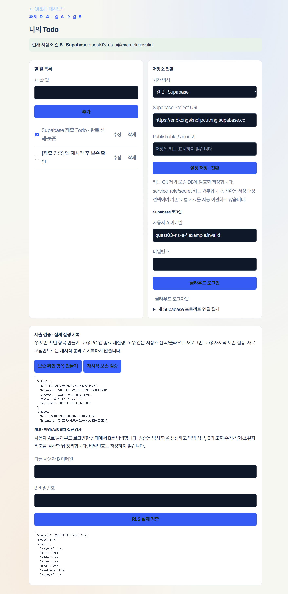

# Quest_03 · 과제 D-4 — 내 Todo 앱과 PRD

**제출 링크:** https://github.com/sorek-charlie/AIFFEL-Quest/tree/main/Quest_03  
**마감:** 2026-11-05 23:59 (한국 시간)

## 프로그램 실행 · 외부 URL · PRD

| 구분 | 링크 / 실행 | 설명 |
|---|---|---|
| 외부 앱 | [charlie_schedule 관리자 열기](https://charlie-schedule.cherrysocute9.chatgpt.site/owner?view=todo) | PC 앱 실행·중계 연결 후 로그인 → **과제 Todo · A/B** |
| 고객 예약 | [외부 고객 신청](https://charlie-schedule.cherrysocute9.chatgpt.site/booking) | 추가 기능이며 Supabase 검증을 대신하지 않음 |
| Windows 로컬 실행 | [ORBIT-Scheduler.exe](./ORBIT-Scheduler.exe) | 이 폴더의 exe를 실행. exe는 로컬 전용이므로 GitHub에는 없음 |
| 소스 실행 | `npm start` | Node.js 24.22.1 이상. 콘솔에 출력된 로컬 주소 열기 |
| PRD 한 장 | [PRD.md](./PRD.md) | 과제 제출용 기능·조건·검증 계획 |
| PRD PDF | [PRD.pdf](./PRD.pdf) | 동일 내용의 A4 한 장 PDF |
| 실제 검증 기록 | [과제 검증 결과](./docs/assignment/verification.md) | 실행한 결과와 미실행 항목 구분 |
| 작동 화면 | [로컬 재시작 전](./Output/submission/todo-local-before-restart.png) · [재시작 후](./Output/submission/todo-local-after-restart.png) | 고객 정보 없는 가상 Todo로 촬영 |

브라우저의 링크는 웹 앱을 엽니다. GitHub에서 Windows 프로그램을 직접 실행할 수는 없습니다. 로컬 exe는 별도 설치 없이 실행되며 데이터는 `%LOCALAPPDATA%\ORBIT Scheduler\data`에 저장됩니다. 외부 관리자는 PC가 켜져 있어야 동작합니다.

## 평가 기준과 현재 결과

| 평가 | 배점 | 구현·검증 상태 |
|---|---:|---|
| PRD 한 장 | 30 | PRD.md 및 한 장 PDF 작성·렌더링 확인 |
| 데이터가 남는 Todo 앱 | 40 | 로컬 추가·조회·수정·완료·삭제 및 재시작 보존 테스트 통과. 작동 화면 첨부 |
| 로컬·Supabase·RLS | 30 | Supabase 실제 연결·CRUD·재시작 보존·익명/A/B RLS 7항목 통과. 전후 화면 첨부 |

**클라우드 전환 기록 한 줄:** 2026-11-01 — SQLite 검증 후 새 Supabase 프로젝트에 사용자 JWT로 전환하여 CRUD·완료·삭제 및 앱 프로세스 재시작/재로그인 뒤 상태 보존 확인(20:51 KST).  
**RLS 확인 기록 한 줄:** 2026-11-01 — 실제 사용자 A/B JWT와 익명으로 검사하여 익명 접근, B의 A 데이터 조회·수정·삭제, 소유자 위조 INSERT/UPDATE를 모두 차단하고 원본 유지 확인(20:49 KST).

[Supabase 재시작 전](./Output/submission/todo-supabase-before-restart.png) · [재시작 후](./Output/submission/todo-supabase-after-restart.png)

## 길 A → 길 B 실행 순서

1. 앱 로그인 → **과제 Todo · A/B** → 길 A(SQLite)에서 할 일 추가·수정·완료·삭제.
2. **보존 확인 항목 만들기** → PC 앱 종료·재실행 → 같은 화면에서 **재시작 보존 검증**. 새로고침만 하면 통과하지 않음.
3. [Supabase Dashboard](https://supabase.com/dashboard) 로그인 → New project로 테스트 프로젝트 생성.
4. SQL Editor에서 [0001_todo_rls.sql](./database/supabase/migrations/0001_todo_rls.sql)을 한 번 실행. Authentication → Users에서 확인 완료된 서로 다른 사용자 A/B 준비.
5. 앱에 Project URL과 **Publishable 또는 anon 키** 입력 → 길 B로 전환 → A 로그인. 키는 암호화 로컬 DB에만 저장하며 Git에서 제외. service_role/secret 키는 거부.
6. 길 B에서 CRUD·완료·삭제 및 종료·재실행·재로그인 후 보존을 확인. B 계정으로 **RLS 실제 검증** 실행.
7. 성공 화면과 전환·RLS 기록을 제출. 현재 검증용 A/B 계정은 암호화 로컬 저장되어 **검증용 사용자 A로 로그인**, **저장된 검증용 B로 RLS 검사** 버튼으로 재현 가능. 본인 계정 로그인도 지원.

저장소 전환은 저장 대상 선택입니다. 기존 로컬 자료를 자동 이관하지 않으며 두 저장소의 자료는 독립적입니다. 같은 Todo 기능을 두 저장소에서 각각 검증했습니다. 일정·예약·Gmail의 원본 DB는 기존 SQLite이며 이번 Supabase 전환 범위는 **과제 Todo**입니다.

## PRD 요약

- **목표:** 앱을 껐다 켜도 남는 개인 Todo. 길 A 완료 후 길 B로 저장 대상 전환.
- **기능:** 1~160자 제목, 추가·조회·수정·완료·삭제, 저장소 표시·선택, Supabase 로그인, 보존·RLS 확인.
- **데이터:** id, 소유자, 제목, 완료 여부, 버전, 생성 시각. 오래된 수정·삭제는 버전 검사로 거부.
- **구조:** 브라우저 → 인증된 Node API → SQLite 또는 Supabase REST. 저장소 선택은 bootstrap에서 결정.
- **보안:** 일반 CRUD는 사용자 JWT와 RLS 적용. anon 접근·타 사용자 접근·소유자 위조 금지. 관리자 키 사용 금지, 키·토큰·DB는 Git 제외.
- **완료 조건:** 각 저장소의 CRUD·재시작 보존 장면 + 두 계정 RLS 실제 결과 + 한 장 PRD.
- **검증:** 360px 모바일·키보드 조작과 자동 테스트. 실제 Supabase 미검증은 미완료로 명시.
- **추가 기능:** ORBIT 일정·프로젝트·예약 승인·Gmail 분류. 추가 기능의 배포 성공은 과제의 Supabase 요구사항과 별개.

## 소스 동기화

`node scripts/sync-github.mjs`로 변경 미리보기, `node scripts/sync-github.mjs --apply`로 반영, `node scripts/sync-github.mjs --watch`로 30초 간격 양방향 확인. 충돌 시 중단합니다. exe/APK/DB/키/토큰/환경파일/런타임·빌드는 제외합니다.

## Google 연결

지정 계정은 **charlie.sungjin@gmail.com**입니다. 입력·연동의 **Google 계정 등록 · 키 발급 절차**를 펼쳐 Desktop OAuth를 연결하세요. Gmail은 메일 확인 → 추출 → 일정·할 일·프로젝트 분류 → 검토 후 반영 순서이며, 반영 항목의 제목으로 원본 Gmail을 엽니다. 실제 OAuth 승인은 사용자가 진행해야 합니다. 카카오톡은 내보낸 TXT·Android 알림 경로이며 전체 수신함 직접 읽기는 지원하지 않습니다.
