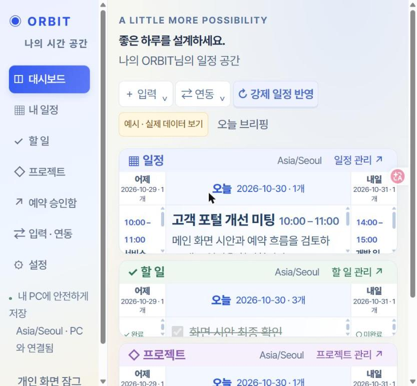
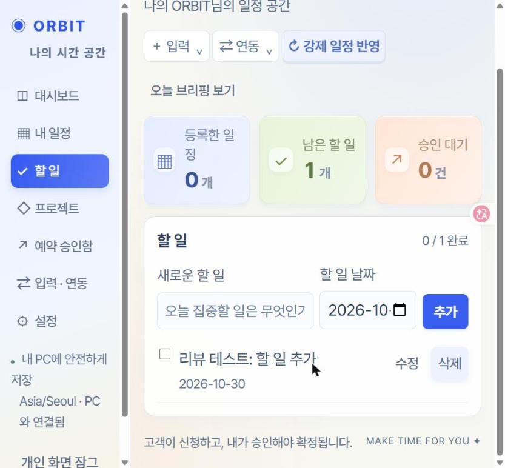
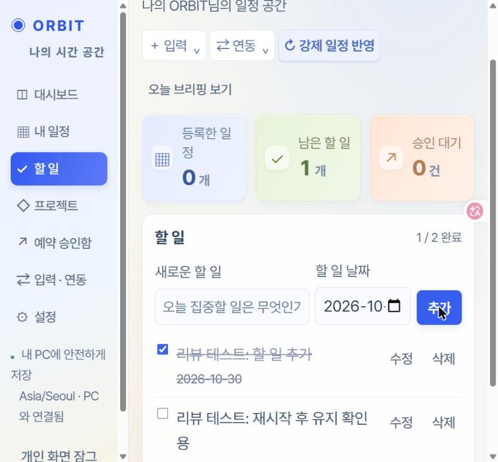
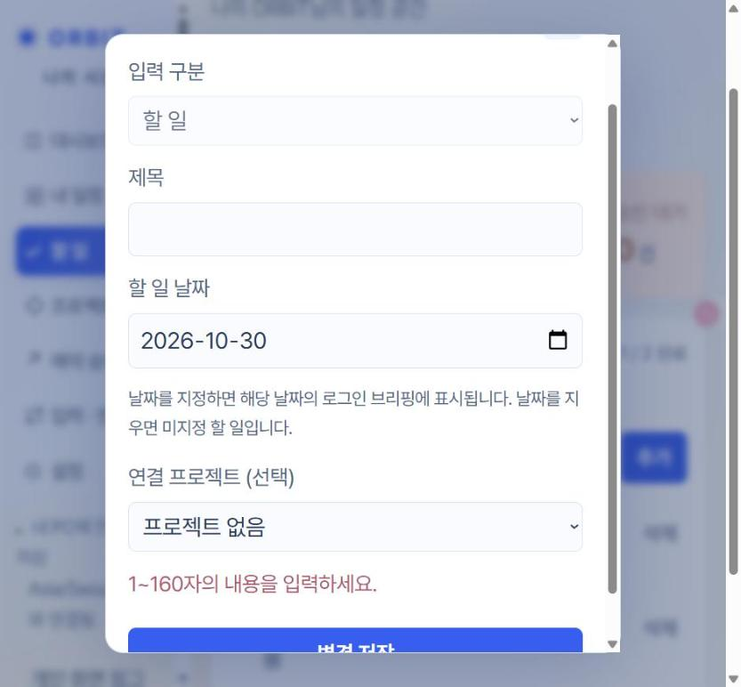
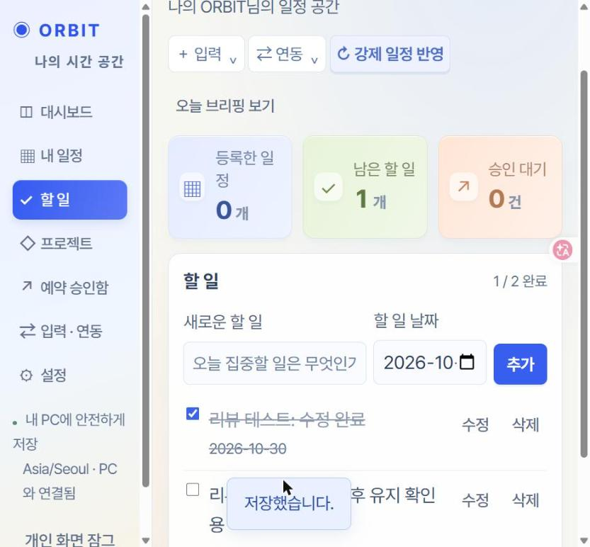
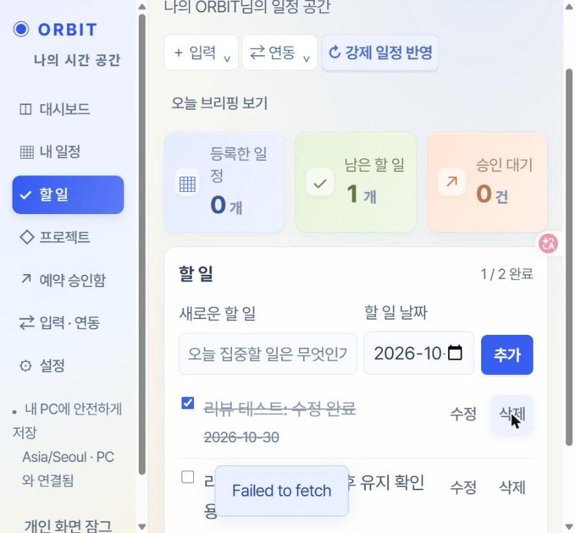
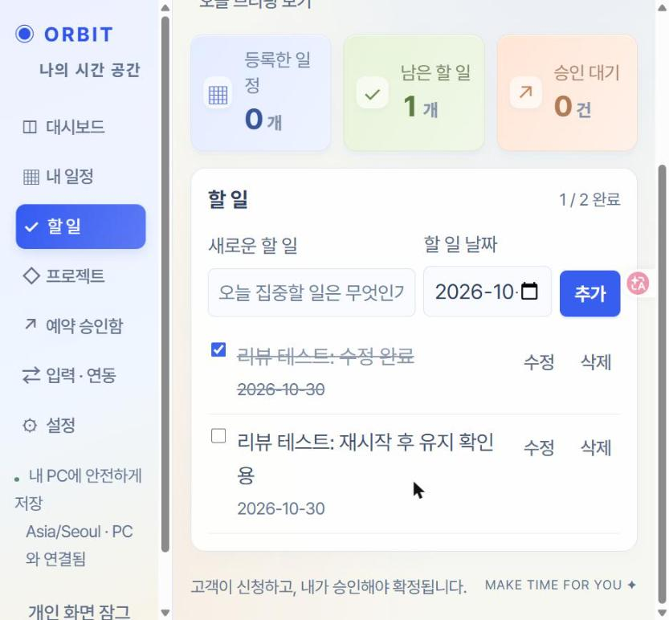
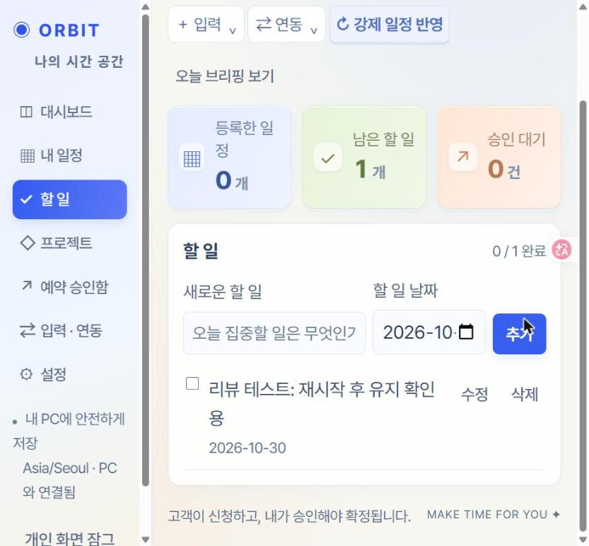

# AIFFEL Campus Agent Code Review Templete
- 개발자 : 이성진
- 리뷰어 : 전재문

> **리뷰 대상**: `Quest_03` — ORBIT Scheduler (개인 일정·할 일·프로젝트 + 승인형 고객 예약)
> **리뷰 방법**
> - 레포지토리 fork → clone 후 `README.md`, `PRD.pdf`, `ORBIT-Scheduler.exe`를 확인했습니다.
> - 레포에는 소스 코드 없이 실행파일만 있어서, exe를 **실행하지 않고** 안에 묶인 ZIP 리소스(앱 소스 151개 항목)를 추출해 코드를 읽었습니다.
> - 아래 코드 경로는 exe 내부 기준(`ORBIT-Scheduler/app/...`)입니다.
> - 그 뒤 리뷰어 PC에서 `ORBIT-Scheduler.exe`를 실행해(Windows 보안 경고 후 실행) 브라우저로 직접 테스트했습니다. 캡처는 `Quest_03/review-evidence/`에 있습니다.

---

# ART(Agent Review Template)

[O]  **1. 원하는 기능이 의도한 대로 동작하나요?**
- 요청(프롬프트)한 기능이 정상적으로 구현되었는지? - 개발자(상대방이 요청한 프롬프트는 확인 불가), PRD 등을 통해 확인해야할듯
- 실제 실행 화면/결과물을 캡처하여 근거로 첨부

**PRD 요구사항 대비 구현 확인 (코드 기준)**

| PRD 항목 | 구현 여부 | 근거 |
|---|---|---|
| FR-02 Todo CRUD·완료·마감일 | O | `apps/api/src/application/scheduler.mjs` `mutate()` — 생성(POST)·수정(PATCH)·삭제(DELETE), `completed`, `dueDate` 처리 |
| FR-02 빈 제목 거부 | O | `packages/domain/src/index.mjs` `title()` — 공백 제거 후 1~160자가 아니면 400 |
| FR-17 재시작 후 유지 (SQLite) | O | `persistence/sqlite/index.mjs` — `node:sqlite` + WAL, 마이그레이션 `0001~0003` |
| FR-03 일정 + 시간 충돌 검사 | O | `scheduler.mjs` `check()` — 겹치면 409 `SLOT_CONFLICT` |
| FR-09/10 빈 시간·고객 신청(pending) | O | `domain/index.mjs` `slots()` (2시간 전~30일, 버퍼 반영), `scheduler.mjs` `request()` |
| FR-12 승인 시 재검사 + 원자적 확정 | O | `decide()` — 하나의 `BEGIN IMMEDIATE` 트랜잭션 안에서 만료→슬롯→충돌 재검사 → event 저장 + 상태 변경 + 감사 기록 |
| 7.4 멱등성 / 동시 수정 | O | `idem()` (키 해시 + body 해시 비교), `version()` (`expectedVersion` 불일치 시 409) |
| FR-15 상태 조회 링크 | O | 32바이트 랜덤 `statusCapability`는 해시로만 저장. 응답에는 상태·시간만 담김 |
| FR-05 3D 보기 | △ | PRD는 Three.js 3D였으나 실제로는 2D `three-day`(어제/오늘/내일) 브리핑과 월간 달력으로 바뀐 것으로 보임 |
| FR-17/18 Supabase 전환·RLS | X | `database/supabase/migrations`·`policies`에는 README만 있음. 클라우드 쪽은 Supabase 대신 Cloudflare Worker/D1 중계로 바뀐 것으로 보임 (`Readme.txt`) |
| AC-08 두 계정 격리 | X | `ownerId='local-owner'` 1인 고정 구조. `database/seeds/scenarios.json` 상태가 `"fixture-plan-not-loaded"` (아래 "사용자 구분 확인" 참고) |

**근거 코드 1 — Todo 생성/수정/삭제와 입력 검증** (`apps/api/src/application/scheduler.mjs`)
```js
mutate(owner,kind,method,id,body) { return repo.transaction(()=>{
  const old=id?get(owner,kind,id):null;
  if(old) version(old,body);                       // 낙관적 잠금 (expectedVersion)
  if(method==='DELETE') { ... repo.remove(owner,kind,id);repo.audit(owner,id,'delete',clock());return {ok:true};}
  let e={id:old?.id||randomUUID(),title:title(body.title),version:(old?.version||0)+1, ...};
  ...
  else if(kind==='task') {requireValue(body.completed===undefined||typeof body.completed==='boolean','완료 값을 확인하세요.');
    e.completed=body.completed??old?.completed??false;e.dueDate=localDate(...);}
```

**근거 코드 2 — 승인 시 재검사 후 원자적 확정** (`scheduler.mjs` `decide()`)
```js
decide(owner,id,action,body,key) {return repo.transaction(()=>idem(`decision:${owner}:${id}:${action}`,key,body,()=>{
  ...
  if(action==='approve') {
    requireValue(b.expiresAt>clock(),'만료된 요청입니다.',410,'REQUEST_EXPIRED');
    const slot=validSlot(owner,b.startsAt, ...);       // 공개 규칙 재검사
    check(owner,Date.parse(b.startsAt),Date.parse(b.endsAt),b.buffer);   // 충돌 재검사
    repo.save(owner,'event',{id:b.id, ..., requestId:b.id});
  }
```
→ PRD 5.3(승인 순간 재검사)과 7.1(pending은 시간을 점유하지 않음)이 코드에 그대로 반영되어 있습니다.

**실행 화면 근거** (리뷰어 PC에서 exe 실행, 2026-10-30)

| 단계 | 결과 | 캡처 |
|---|---|---|
| 로그인 후 대시보드 | ✅ 진입 성공. 처음에는 "예시" 데이터가 표시됨 |  |
| 할 일 추가 | ✅ 목록에 추가되고 "0 / 1 완료"로 갱신 |  |
| 완료 체크 | ✅ 취소선이 그어지고 "1 / 2 완료"로 갱신 |  |
| 빈 제목(공백만)으로 저장 | ✅ 저장되지 않고 "1~160자의 내용을 입력하세요." 표시 (서버 검증 동작) |  |
| 수정 ("항목 수정" 폼) | ✅ "저장했습니다." 표시 후 제목 변경 |  |
| 삭제 (1차) | ⚠️ "Failed to fetch" 표시. 이후 로컬 서버(127.0.0.1) 응답 없음 |  |
| 재시작 후 데이터 유지 | ✅ 프로그램을 다시 실행해도(포트 60890 → 57895) 할 일 2개와 완료 상태가 그대로 유지됨 |  |
| 삭제 (2차, 재시작 후) | ✅ 정상 삭제 ("0 / 1 완료"). 삭제 후에도 서버가 정상 응답함 |  |

> 1차 삭제 실패는 재시작 후 같은 동작으로 **재현되지 않았습니다.** 1차 때 삭제 요청은 처리되지 않았고(재시작 후에도 그 항목이 남아 있었음), 그 시점에 실행 창(서버)이 종료된 것으로 보입니다. 코드상 삭제 처리에서 서버를 멈추게 할 부분은 찾지 못했습니다. 다만 실행 창이 예기치 않게 꺼질 때 화면에 "Failed to fetch"만 보이므로, 개선 제안 ⑧을 참고해 주세요.

**사용자 구분 확인 — 1인 전용 구조**
- 리뷰어가 처음 로그인했을 때 대시보드에 "고객 포털 개선 미팅" 같은 일정이 보여서, 다른 사용자(개발자)의 데이터가 노출되는지 확인했습니다.
- **확인 결과, 보인 일정은 개발자 데이터가 아니라 코드에 고정된 예시 데이터입니다.** 누가 실행해도 똑같이 보입니다.
  ```js
  // apps/web/src/app/owner/demo-state.mjs
  return {_demo:true,settings:{displayName:'ORBIT 예시'}, ... events:[
   {id:'demo-today',title:'고객 포털 개선 미팅', ... participants:'김민수 PM · 이서연 디자이너 · 박지훈 개발자', ...}
  // apps/web/src/app/owner/index.mjs — 기본값이 예시 모드
  let demoMode=sessionStorage.getItem('orbit-today-demo')!=='off';
  ```
  "예시 · 실제 데이터 보기" 버튼으로 전환하면, 리뷰어 PC의 실제 데이터는 비어 있었습니다(할 일 0개, 캡처 01 직전 화면). 데이터는 각자 PC의 `%LOCALAPPDATA%\ORBIT Scheduler\data`에 저장되므로 개발자 데이터가 다른 PC로 넘어가지 않습니다.
- **다만 앱 자체는 사용자를 구분하지 않는 1인용입니다.**
  ```js
  // apps/api/src/bootstrap/server.mjs
  export function createApp({dbPath, ownerId='local-owner', ...}={}) {
    ...
    if(route==='state'&&req.method==='GET') result=app.state(ownerId);   // 모든 요청이 같은 ownerId
  ```
  - 계정이나 회원가입 없이 **PC당 비밀번호 1개**만 있습니다.
  - 같은 PC를 여러 사람이 쓰면 비밀번호를 아는 사람은 모두 같은 일정과 할 일을 봅니다.
  - PRD의 "계정 격리(사용자 A가 B의 데이터를 읽거나 바꿀 수 없음)"와 AC-08, 과제 요구인 "사용자별 RLS 검증"은 이 구조로는 확인할 수 없습니다.
- 예시 데이터가 기본으로 켜져 있고 표시가 작은 버튼뿐이라, 처음 쓰는 사람은 **다른 사람의 실제 일정으로 오해하기 쉽습니다.** 리뷰어도 처음에 그렇게 받아들였습니다.

**Google 캘린더 연동 분석 — 1인용 구조가 된 배경**

개발자 설명에 따르면 이 앱은 Google 캘린더 연동을 중심으로 기획되었습니다. 관련 코드를 확인한 결과, **연동 대상이 개발자 본인의 Google 계정 하나로 고정**되어 있습니다. 이 설계가 앱 전체를 "개발자 개인 PC용 1인 도구"로 만든 직접적인 원인으로 보입니다.

1) 연동 계정이 코드에 고정되어 있음 (`infrastructure/calendar-providers/google.mjs`)
```js
const ACCOUNT='charlie.s*****@gmail.com';            // 개발자 계정 (리뷰에서는 일부 가림)
const SCOPES='.../auth/gmail.readonly .../auth/calendar.readonly';
...
// OAuth 콜백: 로그인한 Google 계정이 ACCOUNT와 다르면 거부
requireValue(profile.emailAddress?.toLowerCase()===ACCOUNT,
  '요청한 Google 계정과 다릅니다. charlie.s*****@gmail.com으로 연결하세요.',403,'ACCOUNT_MISMATCH');
```
- 다른 사람이 exe를 실행해서 자기 Google 계정으로 연결하려고 하면 **`ACCOUNT_MISMATCH`로 항상 거부**됩니다.
- 그래서 리뷰어를 포함한 다른 사용자는 Gmail·Google 일정 연동을 쓸 수 없습니다.
- 서버의 `ownerId='local-owner'`(사용자 1명)와 이 고정 계정이 합쳐져서, 결과적으로 **"이 PC + 이 Google 계정" 한 사람만 쓰는 구조**가 되었습니다.

2) 동기화 방식: Google → ORBIT 한 방향 가져오기 (`sync-manager.mjs`, `inputs.mjs`)

| 대상 | 주기 | 동작 |
|---|---|---|
| Google 캘린더(primary) | 1분 | 지난 1년~앞으로 2년 일정을 가져옴. 이후에는 `syncToken`으로 바뀐 것만 가져옴. Google에서 취소된 일정은 ORBIT에서도 삭제 |
| Gmail 받은편지함 | 1시간 | 최근 7일 메일 **제목**을 `[메일] 제목` 형식의 할 일로 자동 추가 |
| 시간 충돌 시 | - | 자동 반영하지 않고 "검토함"으로 보냄 (409 `SLOT_CONFLICT` 처리) |

- 권한이 `readonly`라서, **ORBIT에서 만든 할 일·일정·승인한 예약은 Google 캘린더에 올라가지 않습니다.** 동기화는 한 방향입니다.
- Google에서 가져온 일정을 ORBIT에서 수정하거나 삭제해도 Google에는 반영되지 않습니다. 같은 내용이 다시 오면 `fingerprint`가 같아서 건너뛰므로, 두 쪽 데이터가 조용히 달라질 수 있습니다.
- 동기화는 PC 프로그램이 켜져 있을 때만 돌아갑니다(`appMustRemainRunning:true`). README에도 이렇게 안내되어 있습니다.

3) 잘 만든 부분
- OAuth에 **PKCE**(`code_challenge S256`)와 랜덤 `state`를 썼고, 콜백을 로그인 세션과 묶어 10분 뒤 만료되게 했습니다(CSRF 방어).
- 요청 권한을 읽기 전용(`readonly`)으로 최소화했습니다.
- 클라이언트 ID·시크릿·refresh token을 코드에 넣지 않고 화면에서 입력받습니다. 저장할 때는 AES-GCM으로 암호화합니다.
- 연결이 안 된 상태에서는 `not_connected`를 반환하고, 동기화에 성공했다고 표시하지 않습니다(PRD 원칙과 일치).

4) 리뷰 중 보인 현상과의 관계

| 현상 | Google 연동과 관련 있나? |
|---|---|
| 1인용(사용자 구분 없음) | **관련 있음.** 개인 Google 계정 하나에 맞춘 설계라 다중 사용자 구조가 빠졌고, PRD의 Supabase·RLS·계정 격리도 구현되지 않음 |
| 첫 화면에 남의 일정처럼 보이는 데이터 | 관련 없음. `demo-state.mjs`의 고정 예시 데이터 |
| 삭제 시 "Failed to fetch" | 관련 가능성 낮음. 리뷰어 PC는 Google이 연결되지 않아 동기화가 바로 `not_connected`로 끝남. 재시작 후에는 재현되지 않음 |

---

[O]  **2. 보안 검토를 수행했나요?**
- API 키, 비밀번호 등 민감 정보가 코드에 하드코딩되지 않았는지
- 사용자 입력값 검증 등 기본 보안 사항 확인
- 외부 데이터/의존성 사용 시 출처와 위험 검토했는지

**(1) 민감 정보 하드코딩 — API 키·비밀번호 없음**
- 전체 소스에서 `sk-`, `AIza`, `eyJ`(JWT), `client_secret`, `api_key` 패턴을 검색한 결과 하드코딩된 키는 없었습니다.
- Google OAuth 클라이언트 ID·시크릿은 앱 화면에서 입력받습니다. 입력값은 DB에 **AES-256-GCM으로 암호화**해 저장합니다.
  ```js
  // persistence/sqlite/index.mjs
  if(!existsSync(keyPath)) writeFileSync(keyPath,randomBytes(32),{mode:0o600,flag:'wx'});
  function seal(value) { const iv=randomBytes(12),c=createCipheriv('aes-256-gcm',key,iv); ... }
  saveConfig(owner,name,value) { ... seal(JSON.stringify(value)) }
  ```
- ⚠️ 다만 **개인 연락처가 코드에 들어 있습니다** → 개선 제안 1 참고.
  - `scheduler.mjs` 6행의 기본 설정값 `senderPhone:'010-****-6269'` (실제 번호, 리뷰에서는 가림)
  - 번들 `Readme.txt`와 `google.mjs` 3행(`const ACCOUNT=...`)의 Google 계정 이메일

**(2) 인증·세션**
```js
// infrastructure/auth/password.mjs — scrypt + salt, timingSafeEqual, 6회 실패 시 15분 잠금
const result=await derive(password.slice(0,128),salt,64);
const ok=!!stored&&timingSafeEqual(result,Buffer.from(stored.hash,'hex'));
if(!ok){if(++failures>=6){lockedUntil=Date.now()+15*60000;failures=0;} ...}
```
```js
// bootstrap/server.mjs — HttpOnly + SameSite=Strict 쿠키, 12시간 만료
res.setHeader('Set-Cookie',`orbit=${token}; HttpOnly; SameSite=Strict; Path=/; Max-Age=43200`);
```
- 초기 비밀번호 설정(`/auth/setup`)에는 실행 창에서만 받을 수 있는 `launchToken`이 필요합니다. 그래서 다른 사람이 먼저 비밀번호를 정해버리는 문제를 막습니다.

**(3) 입력·요청 방어** (`bootstrap/server.mjs`)
| 방어 | 코드 |
|---|---|
| 외부 접근 차단 | `127.0.0.1` 바인딩 + Host 헤더 `^(127\.0\.0\.1\|localhost):\d+$` 검사 (DNS rebinding 방어) |
| CSRF | 쓰기 요청 시 `Origin` 일치 확인 + `Content-Type: application/json`만 허용 |
| 요청 제한 | IP별 분당 300회 → 429 |
| 크기 제한 | 본문 256KB (업로드만 12MB), 파일 8MB, 텍스트 10만 자 |
| XSS | CSP `default-src 'self'; script-src 'self'`, 화면 출력 시 `escape()` 사용 |
| 경로 탐색 | 정적 파일 `resolve()` 후 `web+sep`로 시작하는지 + 확장자 허용 목록 |
| SQL Injection | 모든 쿼리가 `db.prepare(...).run(?,?)` 파라미터 바인딩 |
| 오류 노출 | 500 오류는 `'처리하지 못했습니다'`로만 응답 (스택 트레이스 미노출) |

**(4) 외부 데이터·의존성**
- npm 의존성 없이 Node 내장 모듈(`node:sqlite`, `node:crypto`, `node:http`)만 사용해 공급망 위험이 작습니다. 런타임 `node.exe`와 `NODE-LICENSE.txt`를 함께 넣어 출처를 밝혔습니다.
- 외부 예약 중계 주소는 허용 목록으로 고정되어 있습니다(`https:` + 지정 호스트만). 중계 요청은 AES-GCM으로 암호화되며, 경로도 정규식 허용 목록으로 제한합니다.
  ```js
  // owner-relay.mjs
  if(!/^\/api\/v1\/(owner\/|auth\/(session|login|logout|change-password)$)/.test(p)||p.includes('..')||p.includes('://'))throw new Error('invalid path');
  ```
- ⚠️ 이 중계 기능 때문에, 로컬 전용(127.0.0.1)으로 설계한 관리자 API를 **인터넷에서 비밀번호 하나로** 쓸 수 있습니다. 위험과 대응은 개선 제안 3 참고.

---

[X]  **3. 에러가 난 부분을 디버깅하여 "문제를 해결한 기록"을 남겼나요?** — 확인 불가
- 에이전트가 만든 코드의 오류를 어떻게 발견하고 수정했는지
- 새로운 시도 및 추가 실험이 기록되어 있는지

**확인한 내용**
- 레포의 `Quest_03` 커밋은 2개입니다(`Create Quest_03`, `Add Quest_03 README, standalone Windows executable and PRD PDF`). 소스 코드와 개발 과정 커밋은 올라와 있지 않습니다.
  ```
  $ git log --oneline -- Quest_03
  2c8898b Add Quest_03 README, standalone Windows executable and PRD PDF
  e2b225a Create Quest_03
  ```
- 디버깅 로그, 트러블슈팅 문서, 테스트 코드는 레포와 exe 번들 어디에도 없습니다.

**기록으로 볼 수 있는 흔적 (참고)**
- 번들 `Readme.txt`에 버전별 변경 이력이 있습니다. 예: "업데이트: 로그인 팝업은 오늘만, 메인 화면은 어제/오늘/내일 1:4:1 폭", "업데이트 후 프로그램을 재시작하세요".
- 검증하지 못한 부분을 숨기지 않고 적어 둔 점은 좋습니다. 예: "실제 휴대폰/Google 계정의 종단간 연동은 아직 검증하지 않았습니다. APK는 개발 서명판입니다."
- `AGENTS.md`(api/web/database)에 에이전트 작업 규칙이 정리되어 있습니다. 예: owner_id 신뢰 금지, 로그에 쿠키·연락처 금지, RLS는 익명·A·B 계정으로 실제 검사.
- 다만 "어떤 오류가 났고 어떻게 고쳤는지"를 보여주는 기록은 레포·번들·개발자 설명 어디에서도 확인할 수 없었습니다. 그래서 **확인 불가(X)**로 표기했습니다.

---

# 참고 링크 및 코드 개선

## 1.리뷰 시 참고한 링크가 있다면 링크와 간략한 설명을 첨부합니다.
- [Node.js `node:sqlite` 문서](https://nodejs.org/api/sqlite.html) — 외부 패키지 없이 쓰는 내장 SQLite(`DatabaseSync`) 사용법 확인
- [Node.js `crypto.scrypt` 문서](https://nodejs.org/api/crypto.html#cryptoscryptpassword-salt-keylen-options-callback) — 비밀번호 해시 방식과 기본 파라미터 확인
- [OWASP Password Storage Cheat Sheet](https://cheatsheetseries.owasp.org/cheatsheets/Password_Storage_Cheat_Sheet.html) — scrypt 권장 파라미터(N=2^17 이상) 비교
- [OWASP CSRF Prevention Cheat Sheet](https://cheatsheetseries.owasp.org/cheatsheets/Cross-Site_Request_Forgery_Prevention_Cheat_Sheet.html) — Origin 검사 + SameSite 쿠키 조합이 적절한지 확인
- [Supabase Row Level Security](https://supabase.com/docs/guides/database/postgres/row-level-security) — PRD의 FR-18(RLS) 요구사항과 현재 구현 비교

## 2.리뷰를 통해 개선을 제안할 부분이 있다면 내용과 간략한 설명을 첨부합니다.

**① 코드와 문서에서 개인 연락처 제거** (우선순위 높음)
- `scheduler.mjs` 기본값의 실제 휴대폰 번호와 `Readme.txt`의 개인 이메일이 공개 레포 exe 안에 들어 있습니다.
- 기본값은 `senderPhone:''`로 두고 첫 설정 화면에서 입력받는 방식을 제안합니다. 문서의 계정은 "본인 Google 계정"처럼 일반 표현으로 바꾸면 좋겠습니다.

**② 소스 코드를 레포에 함께 올리기**
- 지금은 37MB짜리 exe만 있어서, 리뷰어나 사용자가 코드를 보려면 바이너리를 직접 풀어야 합니다.
- 서명되지 않은 exe라 Windows SmartScreen 경고도 뜹니다.
- `app/` 소스를 커밋하고 exe는 GitHub Releases로 배포하면, 코드 리뷰도 쉬워지고 레포 용량도 줄어듭니다.

**③ 외부 중계(Worker) 경로의 인증 강화**
- `owner-relay.mjs`를 거치면 인터넷에서 PC의 관리자 API에 접근할 수 있습니다. 이때 방어선은 비밀번호 하나입니다.
- 로그인 실패 잠금이 IP별이 아니라 전역 카운터(`failures`)라서, 외부에서 6번 틀리면 PC 사용자도 15분 동안 잠깁니다(서비스 방해 가능).
- 제안: 중계 경로에 TOTP 같은 2단계 인증 추가, 잠금 카운터를 출처별로 분리, scrypt 비용(N)을 기본값 2^14에서 2^17 수준으로 상향

**④ PRD와 실제 구현 차이를 문서에 반영**
- PRD는 "Three.js 3D, Supabase + RLS, 두 계정 격리"를 P0로 잡았습니다.
- 실제 구현은 "2D 3일 브리핑, Cloudflare D1 중계, 1인 소유자"로 바뀐 것으로 보입니다.
- 과제 평가 항목인 "로컬·클라우드 저장과 보안 (30점)"에 맞추려면 두 가지가 필요합니다.
  - 바뀐 이유를 PRD나 README에 한 줄로 남기기
  - 클라우드 저장 + 접근 제한 검증 결과를 `evidence/` 폴더에 남기기

**⑤ 테스트·디버깅 기록 추가**
- `database/seeds/scenarios.json`에 경쟁 승인, 만료, DST 같은 좋은 시나리오가 정의되어 있지만, 상태가 `fixture-plan-not-loaded`입니다.
- 제안: PRD 13장의 AC-01(재시작 유지), AC-04(동시 승인), AC-05(멱등성)를 `node --test`로 자동화하고, 실패→수정 과정을 `TROUBLESHOOTING.md`에 남기기. ART 3번 항목의 근거로도 쓸 수 있습니다.

**⑥ 사용자 구분과 예시 데이터 표시**
- 사용자 구분: 지금은 `ownerId='local-owner'` 1인 구조입니다. 과제의 "사용자별 데이터 분리·RLS" 요구에 맞추려면 로그인 계정별로 `owner_id`를 정하는 구조가 필요합니다. 예를 들어 Supabase Auth의 `auth.uid()`와 RLS 정책을 쓰거나, 로컬에서도 사용자 테이블과 세션의 사용자 ID를 쓰는 방식입니다. 개인 PC 전용 앱으로 범위를 정한 것이라면 README와 PRD에 "1인용"이라고 밝혀 두는 것을 제안합니다.
- 예시 데이터: 첫 화면에서 예시 모드가 기본으로 켜져 있습니다. 실제 데이터와 헷갈리지 않도록 두 가지를 제안합니다.
  - 기본값을 실제 데이터로 두거나, 실제 데이터가 비어 있을 때만 예시를 보여 주기
  - 예시일 때는 화면 상단에 "예시 데이터입니다" 배너를 크게 표시하기

**⑦ Google 연동을 "누구나 자기 계정으로" 쓸 수 있게**
- 고정 계정을 없애야 합니다. `ACCOUNT` 상수와 `ACCOUNT_MISMATCH` 검사를 지우고, OAuth로 연결된 계정(`profile.emailAddress`)을 그대로 저장하면 됩니다. 그러면 다른 사람도 자기 Google 캘린더를 연동할 수 있고, 코드에서 개인 이메일도 빠집니다.
- 여러 사람이 함께 쓰는 서비스로 키우려면 Google 연동 정보(refresh token)를 사용자별로 저장해야 합니다(`owner_id`별 `private_config`). 이 작업은 ⑥의 사용자 구분과 같이 진행해야 합니다.
- 한 방향 동기화라는 점을 화면에 밝혀 주세요. 예: "Google → ORBIT 가져오기만 지원". 양방향이 목표라면 `calendar.events` 쓰기 권한과 충돌 처리 규칙을 PRD에 추가하는 것을 제안합니다.
- Gmail 제목이 자동으로 할 일이 되는 기능은 개인정보가 많이 들어오는 기능입니다. 기본값을 "끔"으로 하고 사용자가 직접 켜도록 하는 것이 안전합니다.

**⑧ 작은 사용성 개선**
- 할 일 삭제에 확인 단계나 실행 취소가 없습니다.
- 서버(실행 창)가 꺼지면 화면에는 브라우저 기본 메시지인 "Failed to fetch"만 표시됩니다. `platform/api/index.mjs`의 `api()`에서 `fetch` 실패를 잡아 "ORBIT 실행 창이 종료되었습니다. 프로그램을 다시 실행해 주세요."처럼 안내하면 사용자가 원인을 알 수 있습니다.

---

# 총평

Todo 앱 과제를 **"고객 예약을 직접 승인하는 개인 일정 서비스"** 로 확장한 야심 찬 프로젝트입니다.

- **PRD 완성도**: 14쪽 PRD가 상태 전이, 동시성, 멱등성, 개인정보 공개 범위, 수용 시나리오까지 실무 수준으로 정리되어 있습니다. "아직 검증하지 않은 항목은 체크하지 않는다"는 원칙을 문서 전체에서 지킨 점이 인상적이었습니다.
- **코드 품질**: 핵심 로직이 PRD 설계를 충실히 따릅니다. 승인 시 재검사 + 단일 트랜잭션 확정, 버전 기반 동시 수정 방지, 멱등성 키, 해시로만 저장하는 상태 조회 토큰이 그 예입니다. 보안 기본기도 탄탄합니다. scrypt, HttpOnly/SameSite 쿠키, Origin 검사, CSP, Host 검사, 파라미터 바인딩, 비밀값 AES-GCM 암호화를 모두 적용했습니다. 외부 npm 의존성이 없는 점도 좋았습니다.
- **아쉬운 점**:
  - 소스가 레포에 없고 exe만 있어서 리뷰하기 어렵습니다.
  - 코드에 실제 연락처가 들어 있습니다.
  - PRD의 Supabase·RLS·계정 격리가 실제 구현과 다릅니다. 실제 앱은 PC당 비밀번호 1개인 1인용 구조입니다.
  - Google 캘린더 연동이 개발자 계정 하나로 고정되어 있습니다. 이것이 1인용 구조가 된 주된 배경으로 보이고, 다른 사용자는 연동 기능을 쓸 수 없습니다.
  - 예시 데이터가 기본으로 보여서, 처음 쓰는 사람이 다른 사람의 일정으로 오해할 수 있습니다.
  - 디버깅·테스트 기록이 남아 있지 않습니다.

위 개선 제안 ①·②만 반영해도 공개 레포로서 완성도가 크게 올라갈 것 같습니다. 고생 많으셨습니다! 🙌
