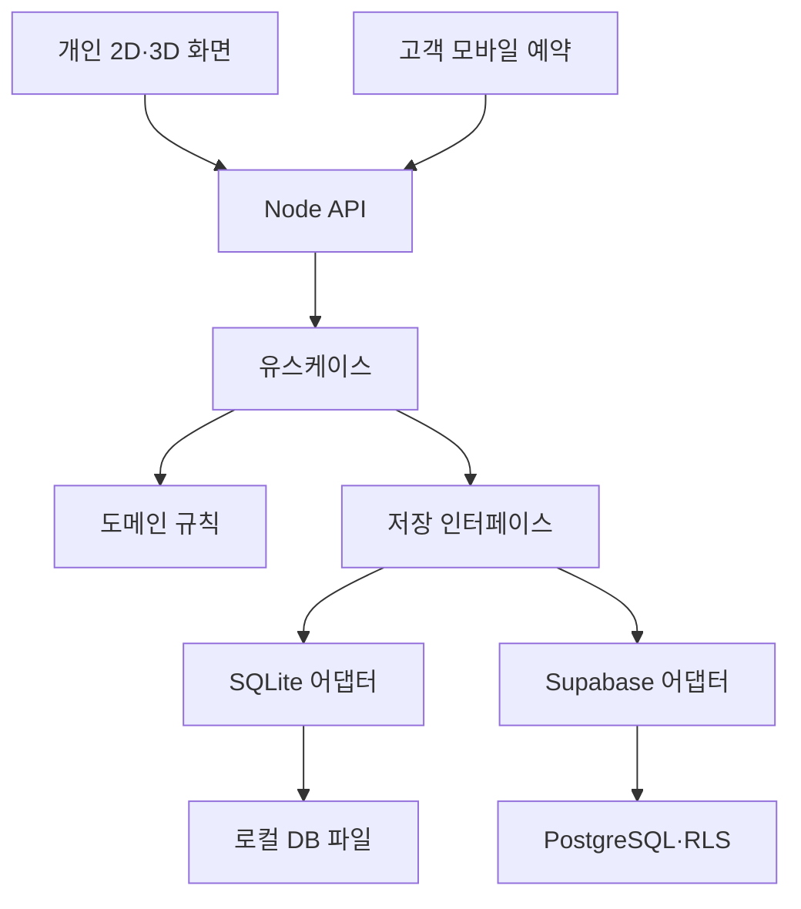

# 전체 아키텍처

## 배치 단위

웹 앱 1개 + Node API 1개 + 선택한 DB 1개로 시작합니다. 기능별 경계는 명확히 하되 별도 마이크로서비스·메시지 브로커·Kubernetes를 먼저 도입하지 않습니다.

두 어댑터는 실행 시 하나를 선택합니다. 브라우저가 DB에 직접 연결하는 경로는 없습니다.

## 기술 선택안

| 계층 | 선택안 | 이유/제약 |
|---|---|---|
| 화면 | React + TypeScript + Vite | 개인·공개 라우트의 분할 로딩, 정적 웹 배포 |
| 3D | Three.js + React Three Fiber + 필요한 Drei 기능 | React 상태와 연결, owner 경로에 한정 |
| 서버 | Node.js + TypeScript, Fastify 후보 | 한 API로 로컬/클라우드 어댑터 교체 |
| 로컬 DB | SQLite | 첨부 과제와 파일 영속성 학습 |
| 클라우드 | Supabase PostgreSQL + Auth | 인증·RLS와 원자적 함수 |
| 검증 | 순수 규칙 테스트 + API 통합 + Playwright 후보 | 동시성·권한·실제 화면을 분리 검증 |

이 표는 채택할 기술 방향입니다. 앱 패키지는 아직 설치하지 않았고 정확한 버전은 구현 시 검증·고정합니다. 현재 확인한 R3F 공식 문서에서는 React19와 R3F9가 대응합니다.

## 데이터 기준

DB → API DTO → 화면 캐시 → 2D/3D 뷰모델 순서입니다. 3D 장면이 별도 일정을 저장하지 않습니다.
승인 결과는 서버 커밋 뒤 반영합니다. 클라이언트에서 즉시 보여주는 낙관적 상태는 요청중 표시까지만 허용합니다.

## 호스팅 경계

과제 경로는 Node + SQLite/Supabase입니다. Workers 전용 환경에는 로컬 SQLite 파일·Node 런타임을 그대로 올릴 수 있다고 가정하지 않습니다. 다른 호스팅을 선택하면 별도 저장소/런타임 ADR이 필요합니다.
