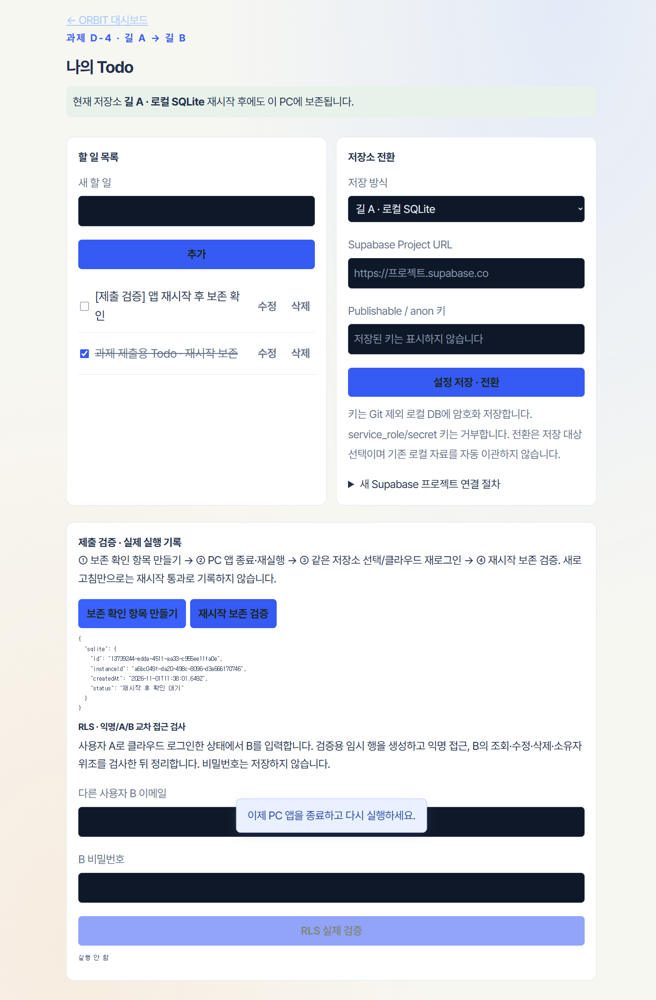
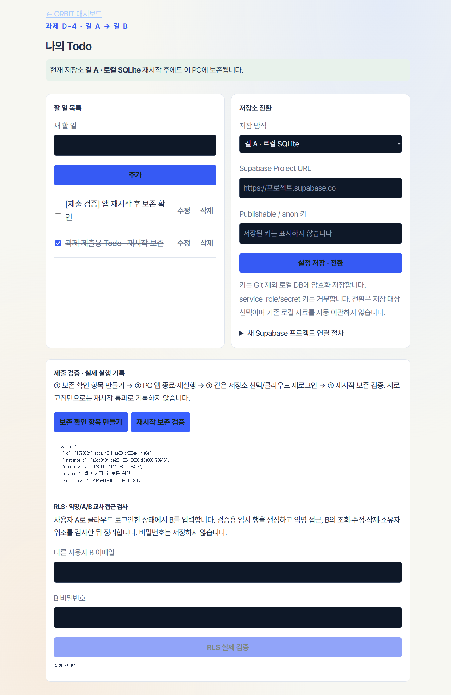
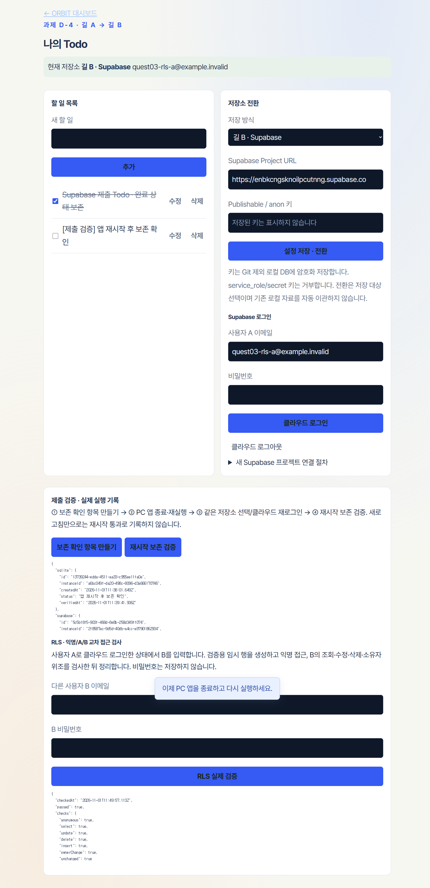
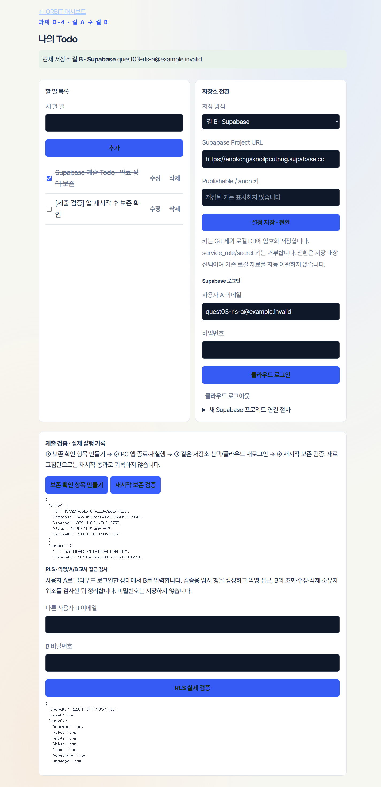

# 과제 D-2 · 내 Todo 앱과 PRD

제출: https://github.com/sorek-charlie/AIFFEL-Quest/tree/main/Quest_03  
마감: 2026-11-05 23:59 KST

| 평가 항목 | 결과물과 확인 내용 |
|---|---|
| PRD 한 장 · 30점 | [PRD.md](../../PRD.md), [PRD.pdf](../../PRD.pdf): 목표·기능·조건·보안·완료 기준. PDF 1쪽 확인. |
| 데이터가 남는 앱 · 40점 | Todo 추가·조회·수정·완료·삭제, 로컬 재시작 보존 자동 테스트 통과. 아래 실제 작동 화면 첨부. |
| 로컬·클라우드·보안 · 30점 | SQLite → Supabase 전환과 실제 A/B JWT RLS 7항목 검증 기록. 클라우드 최신 재검증 한계는 아래 명시. |

## 작동 화면

### 길 A · 로컬

### 길 B · Supabase

클라우드 전환: 2026-11-01 — SQLite 확인 후 Supabase 사용자 JWT로 CRUD·완료·삭제, 앱 종료·재실행·재로그인 후 보존 확인.

RLS 확인: 2026-11-01 — 익명 접근 및 사용자 B의 A 자료 조회·수정·삭제, 소유자 위조 생성·변경 차단 등 7항목 통과.

## 최신 확인과 남은 부분

2026-11-03: 최신 전체 자동 테스트 28개 통과. 이 중 Supabase REST 계약 테스트는 합성 응답이며 실제 클라우드 검증과 구분한다. PRD PDF 1쪽 확인.

2026-11-03 실제 클라우드 재접속은 저장된 검증 계정 로그인 단계에서 실패했다. 따라서 클라우드 재시작·RLS 최신 재검증을 성공했다고 표시하지 않는다. 위 실제 증거는 2026-11-01 실행 기록이다. 현재 계정 비밀번호를 앱에서 재설정·입력한 뒤 클라우드 로그인 → 완료/삭제 → 보존 확인 항목 만들기 → 앱 종료·재실행 → 재로그인 → 재시작 보존 검증 → 다른 사용자 B로 RLS 실전 검증을 다시 수행하면 최신 증거를 추가할 수 있다. 비밀번호는 채팅에 보내지 않는다.

## 공개 열람

[브라우저에서 바로 실행](https://charlie-schedule.cherrysocute9.chatgpt.site/viewer.html) · 공개 비밀번호 `Quest03-View-2026!`. 실행 중인 PC의 실제 일정·할 일·프로젝트 전체를 실시간으로 열람하며 입력·수정·삭제는 차단합니다. 실제 저장·RLS 검증 증거는 위 작동 화면과 검증 기록입니다.

## 실행

Windows: 폴더의 Charlie's Scheduler.exe 실행. 실행 파일은 로컬 전용으로 Git에 포함하지 않는다. 소스는 저장소 내려받기 후 Node.js 24.22.1 이상에서 npm start.

외부 공개 화면: https://charlie-schedule.cherrysocute9.chatgpt.site/viewer.html (PC 실제 자료, 실시간 읽기 전용, PC 실행 필요). 과제 Todo 저장소 전환은 설정에서 연다. 배포 화면은 PC 서버 없이 독립적으로 실행되는 클라우드 API가 아니다.

[전체 검증 기록](./verification.md)
