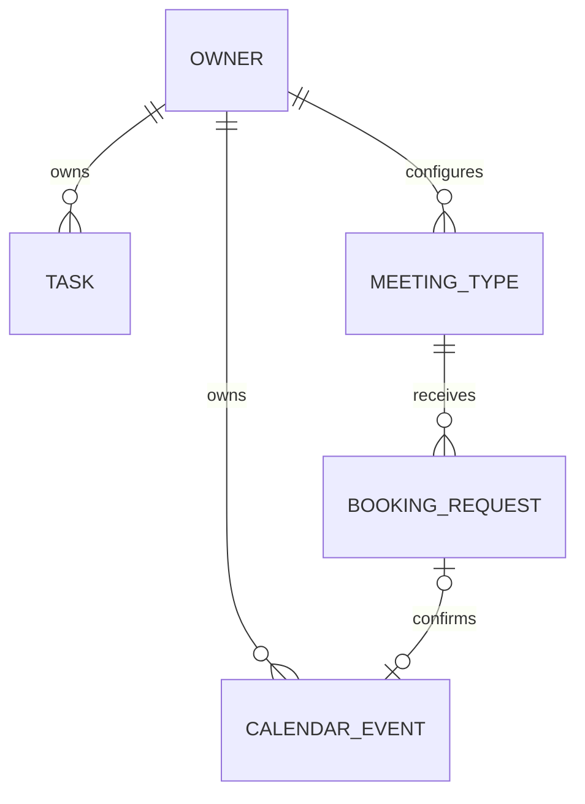

# 데이터 설계 · 실행 DDL 아님

| 테이블 | 주요 필드 | 관계·제약 |
|---|---|---|
| owners | id, timezone, created_at | cloud id는 auth 사용자 ID와 일치 |
| public_profiles | owner_id, slug, display_name, enabled | slug UNIQUE, 공개 필드만 |
| tasks | id, owner_id, title, completed, due_at?, version | 제목 길이, owner FK |
| calendar_events | id, owner_id, task_id?, request_id?, starts_at, ends_at, busy_start, busy_end, active, title, category | start<end, request_id UNIQUE, owner/time 인덱스 |
| meeting_types | id, owner_id, slug, duration_min, step_min, buffer_before, buffer_after, active | duration/step 양수, owner+slug UNIQUE |
| availability_rules | id, owner_id, weekday, local_start, local_end | 같은 날 구간, weekday 범위 |
| availability_exceptions | id, owner_id, local_date, intervals_json | owner+date UNIQUE, 빈 배열=휴무 |
| booking_requests | id, owner_id, meeting_type_id, starts_at, ends_at, status, expires_at, version, guest_name, guest_email, note?, capability_hash | 상태 CHECK, owner/time 인덱스 |
| idempotency_records | actor_scope, operation, key_hash, body_hash, result_ref, expires_at | scope+operation+key UNIQUE |
| audit_events | id, owner_id, entity_id, action, at, actor_kind | 상태변화·참조 ID만, 연락처·토큰 제외 |
| sessions | id_hash, owner_id, expires_at, provider_token_ciphertext? | 서버 전용·공개 schema 외부 |

예약 미팅 길이·버퍼는 신청 시 스냅샷을 남기는 필드를 추가합니다. 승인 시 타입이 바뀌었으면 조용히 시간을 바꾸지 않고 재신청을 안내합니다.
외래키가 연결될 때 부모/자식 owner 일치도 검증합니다. 다른 사용자의 task_id나 meeting_type_id를 연결할 수 없어야 합니다.

## 점유와 충돌

calendar_events가 active 점유의 단일 기준입니다. 확정 예약과 개인 일정 모두 같은 테이블·충돌 경계를 사용합니다.
Postgres는 owner_id와 `tstzrange(busy_start,busy_end,'[)')`를 이용한 exclusion constraint를 계획합니다. 확장/권한 지원은 migration 구현 시 확인합니다.
SQLite에는 같은 제약 문법이 없으므로 쓰기 트랜잭션 안의 겹침 조회와 모든 변경 경로 일원화로 보장하고 경쟁 테스트를 수행합니다.
첫 버전은 시간을 점유하는 개인 일정의 겹침도 금지합니다. 겹쳐 보관할 메모는 비점유 항목으로 별도 처리합니다.

## 소유자 삭제

사용자 삭제는 세션·공유 링크 비활성 → 관련 데이터 정책에 따른 삭제 순서로 설계합니다. 무차별 cascade는 추후 감사/보존 정책을 결정한 뒤 적용합니다.
