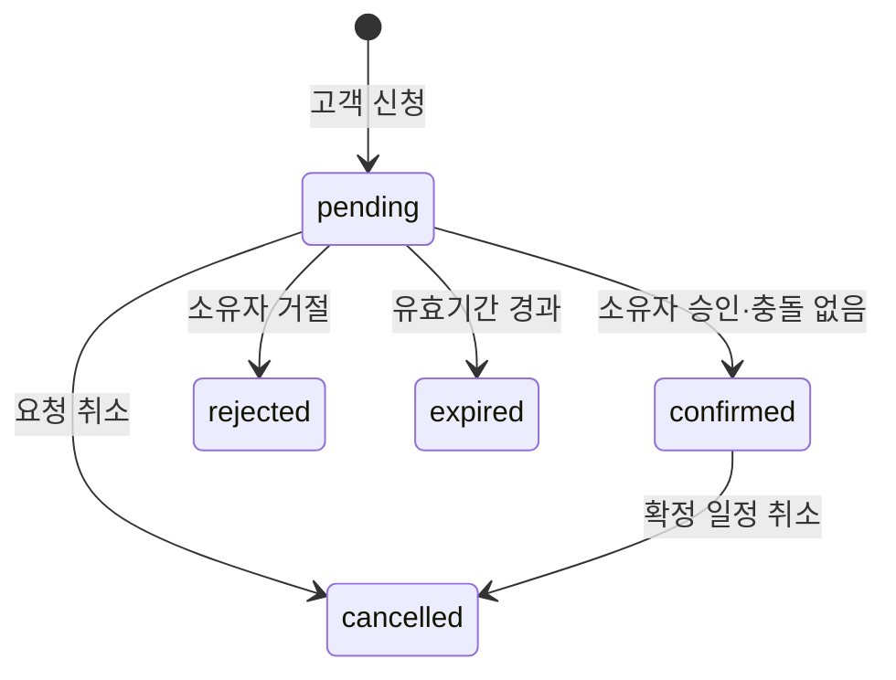

# 예약 상태와 승인 트랜잭션

| 상태 | 고객 문구 | 시간 점유 |
|---|---|---|
| pending | 요청을 보냈습니다. 주최자 승인 후 확정됩니다. | 없음 |
| confirmed | 약속이 확정되었습니다. | 있음 |
| rejected | 요청이 수락되지 않았습니다. | 없음 |
| cancelled | 요청/약속이 취소되었습니다. | 없음 |
| expired | 요청 유효기간이 지났습니다. 다시 신청해 주세요. | 없음 |

## 승인 처리의 원자성

1. 인증된 owner와 요청의 owner가 일치하는지 확인합니다.
2. 멱등성 키·요청 버전 확인, 소유자의 일정 직렬화 잠금을 획득합니다.
3. pending 여부·서버 시각 기준 만료·미팅 유형 활성·최신 공개 규칙을 재검사합니다.
4. effective interval을 기준으로 기존 active 점유와 충돌을 검사합니다.
5. 요청을 confirmed로 변경하고 linked calendar event, 감사 기록, 멱등성 결과를 **한 번에 커밋**합니다.
6. 성공 뒤 UI 캐시를 갱신합니다. 외부 알림은 후속 단계에서 outbox로 분리합니다.

실패하면 부분 저장 없이 rollback합니다. 중복 클릭·네트워크 재전송은 기존 승인 결과를 반환하며 새 일정을 만들지 않습니다.
같은 Idempotency-Key로 다른 body를 보내면 409 IDEMPOTENCY_MISMATCH입니다. 멱등성 기록은 actor+operation+key로 구분합니다.

## DB별 구현 계약

SQLite: 모든 일정 점유 변경에 BEGIN IMMEDIATE 적용, 동일 파일의 쓰기 직렬화 안에서 검사/변경. SQLITE_BUSY는 제한 재시도 후 명시적 오류로 응답합니다.
Postgres: owner 행 `FOR UPDATE`로 승인·일정 추가/변경·공개 규칙 변경을 직렬화합니다. 구간 겹침 exclusion constraint도 최종 방어로 사용합니다.
Supabase의 승인 RPC는 하나의 DB 트랜잭션이어야 합니다. 직접 DML을 제한하고 같은 경계를 거치는 함수만 변경을 허용해야 이 계약이 유지됩니다.

## 취소·변경

확정 취소는 상태 변경과 연결된 event의 active 점유 해제를 함께 커밋합니다. 고객 취소는 제한된 capability와 정책 검사를 거칩니다.
첫 버전의 예약 시간 변경은 취소 후 새 신청입니다. 일반 개인 일정의 이동은 동일 충돌 처리로 제공합니다.
유효기간은 `min(신청시각 + 24시간, 예약시작시각)`을 초기 정책으로 제안합니다. 만료 정리 작업이 늦어도 승인 시 서버가 만료를 거절합니다.

이는 구현 계약이며 트랜잭션 코드·DB 제약은 아직 작성하지 않았습니다.
