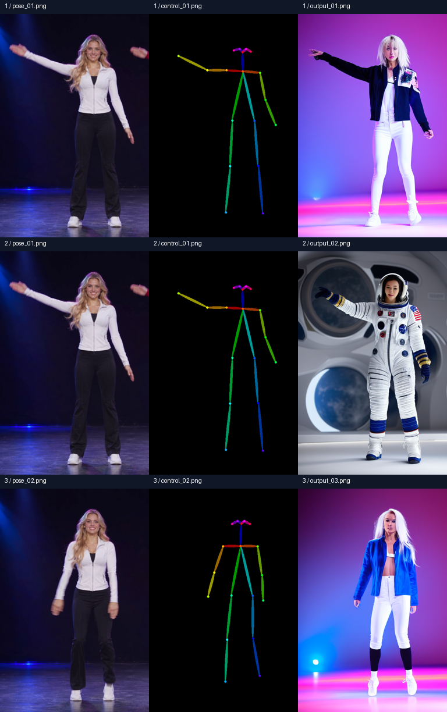

# 원하는 포즈로 이미지 만드는 도구 — 과제 D-7

참조 사진의 OpenPose 관절을 조건으로 프롬프트에 맞는 새 이미지를 만듭니다. 실제 이미지 실험 3개와 음악 포함 41초 댄스 데모를 정리했습니다.

## 바로 실행

**Windows: [start_demo.cmd](start_demo.cmd)를 더블클릭**합니다. Python 3가 설치되어 있어야 하며 추가 패키지는 필요 없습니다. 브라우저에 포즈·프롬프트·LED 관절·완성 영상·제출 파일 전체 링크가 나타납니다. 로컬 주소는 `http://127.0.0.1:8765/demo.html`입니다. 서버는 이 PC에서만 접근됩니다. 종료하려면 실행 중인 `demo_server.py` Python 프로세스를 종료합니다.

빠른 로컬 데모는 이미 생성한 고정 결과를 재생합니다. 프롬프트의 양팔/V자·무릎 키워드는 관절 미리보기에만 반영됩니다. **새 사진·새 프롬프트로 실제 이미지 생성은 아래 Colab 노트에서 실행**합니다.

## Colab 사용법

1. [pose_tool.ipynb](pose_tool.ipynb)를 Colab의 파일 → 노트 업로드로 엽니다.
2. 런타임 유형을 T4 GPU로 바꿉니다.
3. 셀을 위에서 아래로 실행하고 [pose_inputs.zip](pose_inputs.zip)을 업로드합니다. 또는 `pose_01.png`, `pose_02.png` 두 PNG를 선택합니다.
4. 관절 추출 셀에서 참조 사진과 OpenPose 지도를 확인합니다. 3개 생성 실험을 실행합니다.
5. 입력 UI에서 포즈와 프롬프트를 바꾸고 '관절 조건으로 새 이미지 생성'을 누를 수 있습니다.
6. 결과 ZIP을 내려받습니다. 셀마다 역할을 설명했으며 마지막 마크다운 셀에 실제 관찰을 기록했습니다.

입력 파일이 사라진 런타임은 업로드 셀이 다시 안내합니다. 이전의 특정 MP4 경로를 전제로 한 `AssertionError` 구조를 사용하지 않습니다.

## 실제 실행 결과

Colab Tesla T4 / 실행일 2026-11-12 / SD 1.5 + OpenPose ControlNet. 시드 42, 25스텝, CFG 7.5, ControlNet 강도 1.0, 512×768을 세 실험에서 고정했습니다.

| 실험 | 포즈 | 프롬프트 | 결과·관찰 |
|---|---|---|---|
| 01 | 한 팔 올리기 | A: 무대 댄서 | 올린 팔과 내린 팔의 큰 자세를 따라갑니다. 의상 색은 요청과 다릅니다. |
| 02 | 01과 동일 | B: 우주비행사 | 팔 자세를 유지하며 우주복·우주선 내부처럼 보이는 배경으로 바뀝니다. |
| 03 | 양팔 내리기 | 01과 동일 | 양팔이 내려갑니다. 얼굴·의상 세부는 01과 완전히 같지 않습니다. |

실행 증거: [설정·실행 시간](samples/execution_evidence.json), [패키지 버전](samples/environment.json), [실험 조건](samples/experiments.json).

## 추가 41초 영상 데모

[음악 포함 최종 MP4](dance_final_41s.mp4) · [LED 관절 MP4](samples/led_motion_41s.mp4) · [인물 참조 이미지](samples/blonde_dancers_reference.png) · [시간별 프롬프트](prompts.md)

직접 작성한 LED 관절 시간표 → Higgsfield Genjutsu 모션 트랜스퍼 → 가상 금발 성인 여성 두 명. 생성 결과의 20.5초를 두 번 연결하고 사용자 녹화의 오디오를 합쳤습니다. 최종 검증: **41.000초, 1112×834, H.264 24fps, AAC 오디오**. 이 영상은 SD 1.5 이미지 실험과 별도입니다. GD의 실제 관절을 추출한 최종본은 아닙니다. 깨끗한 별도 음원 대신 녹화의 음악·해설·현장 소리가 포함됩니다.

## 제출 준비 파일

- [전체 패키지 ZIP](pose-image-tool_submission.zip)
- [README.md](README.md) — 도구 설명·사용법·실제 결과·한계
- [pose_tool.ipynb](pose_tool.ipynb) — 셀별 설명·실제 생성 코드·마지막 관찰
- [prompts.md](prompts.md) — 프롬프트 원문·실험 조건·41초 동작 시간표
- [입력 ZIP](pose_inputs.zip) — Colab용 참조 사진 2개
- [samples/ 파일 목록](samples/README.md) — 참조·관절·실제 결과·비교판·실행 증거
- [start_demo.cmd](start_demo.cmd), [launch_demo.py](launch_demo.py), [demo_server.py](demo_server.py), [demo.html](demo.html) — 로컬 실행 화면
- [dance_final_41s.mp4](dance_final_41s.mp4) — 추가 데모

## 한계와 자료 출처

- 실험 01·03의 'white sports jacket, black trousers'는 충실히 반영되지 않았습니다. 어두운/파란 재킷과 흰 바지가 나왔습니다.
- 몸 OpenPose만 사용해 손가락·표정·옷 주름은 제어하지 못했습니다. 관절 지도와 결과의 손끝 위치·팔 각도에도 오차가 있습니다.
- 포즈 참조는 생성된 가상 성인 여성 영상에서 왼쪽 인물을 잘라 만든 이미지입니다. 첫 참조 가장자리에는 다른 인물의 손 일부가 남아 있습니다. 관절 지도는 주된 한 인물을 검출했습니다.
- 두 조건쌍을 한 시드에서 비교한 정성 관찰입니다. 포즈와 프롬프트 중 어느 쪽의 영향이 항상 더 크다고 일반화하지 않습니다.

참조 사진은 이 프로젝트에서 생성한 가상 성인 여성 영상의 0.5초·8.5초에서 왼쪽 인물을 잘라 만든 것입니다. 인물 사진의 재현 목적은 포즈이며 특정 실존 인물의 얼굴을 복제하지 않았습니다. 첨부 강의 PDF의 예시 사진을 제출 이미지로 재사용하지 않았습니다.

사용 모델: [SD 1.5](https://huggingface.co/stable-diffusion-v1-5/stable-diffusion-v1-5), [OpenPose ControlNet](https://huggingface.co/lllyasviel/control_v11p_sd15_openpose). 구현: [Diffusers 0.35.1](https://huggingface.co/docs/diffusers/v0.35.1/en/api/pipelines/controlnet). 추가 영상: [Genjutsu 안내](https://higgsfield.ai/creator-hub/help-center/tools/how-do-i-use-genjutsu). 사용 모델의 라이선스는 각 모델 카드를 따릅니다. 음악의 별도 공개 배포 허가를 확보했다는 의미는 아닙니다.

## 과제 상태

제출용 산출물을 [GitHub의 Quest_05 폴더](https://github.com/sorek-charlie/AIFFEL-Quest/tree/main/Quest_05)에 정리했습니다. 공식 제출 방식은 공개 GitHub 저장소 URL 한 줄이며, 학습 사이트 제출란 등록은 별도입니다. 마감은 2026년 11월 18일 23:59이며, 게시할 때는 포함할 음원·영상의 공개 범위를 따로 결정해야 합니다.
