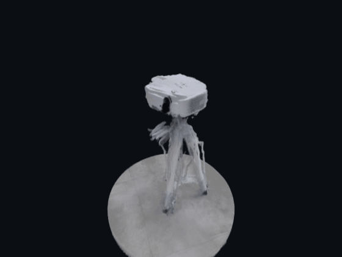
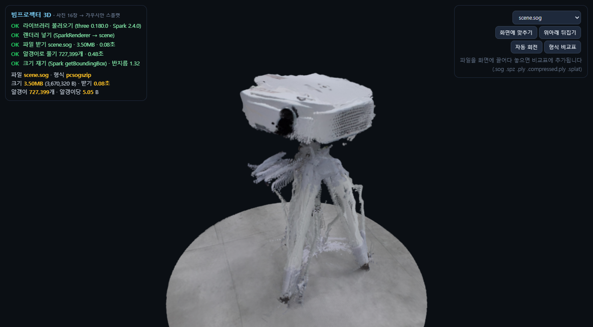
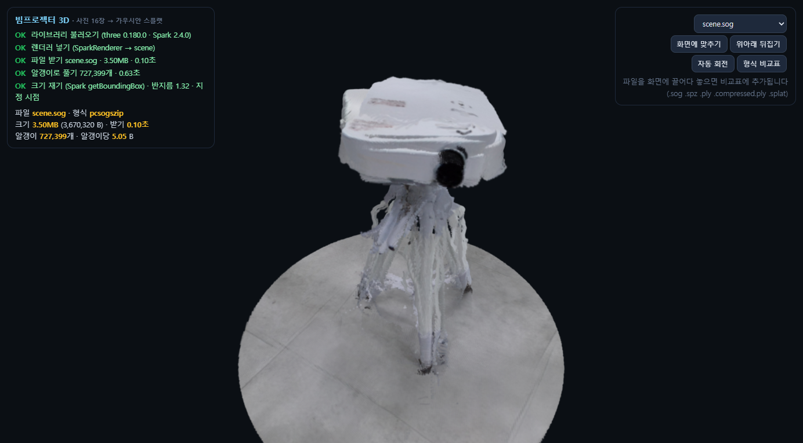
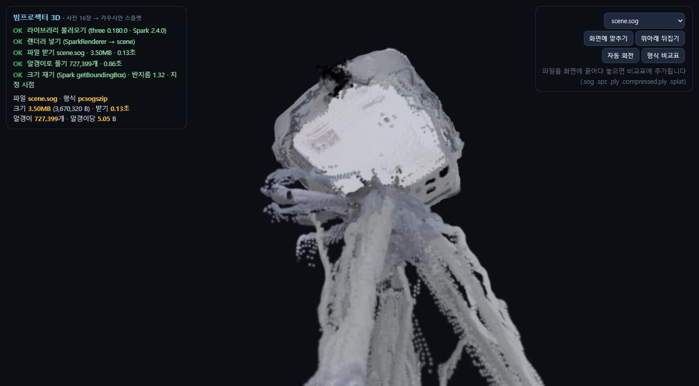
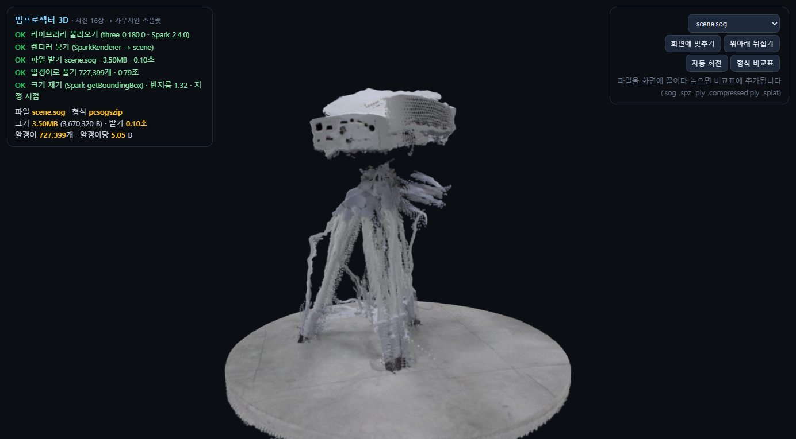

# 빔프로젝터 3D — 공개 가능한 공간의 3D 뷰어

노드07 「우리가 사는 3차원은」 과제 제출물입니다.
사진 16장 → MapAnything(점과 카메라) → 가우시안 스플랫 `.ply` → `.sog` 로 줄여 → 브라우저 뷰어

[](https://sorek-charlie.github.io/AIFFEL-Quest/Quest_06/)

**▶ [3D 뷰어 열기 (마우스로 돌려 보기)](https://sorek-charlie.github.io/AIFFEL-Quest/Quest_06/)**: 위 그림을 눌러도 열립니다.
GitHub README 는 보안상 자바스크립트를 실행하지 않아서, README 안의 그림은 회전 GIF 로만 보여 줄 수 있습니다. 직접 조작은 뷰어에서 합니다.

| 조작 | PC | 폰 |
|---|---|---|
| 돌리기 | 왼쪽 버튼 끌기 | 한 손가락 끌기 |
| 상하좌우 이동 | 오른쪽 버튼 끌기 (또는 Shift+끌기), 방향키 | 두 손가락 끌기 |
| 확대·축소 | 휠 | 두 손가락 벌리기 |
| 자동 회전 | 처음부터 켜져 있음. 끄는 동안 멈췄다가 손을 떼고 3초 뒤 다시 돎. 오른쪽 위 단추로 끄기 | 같음 |



| 제출 | 주소 |
|---|---|
| Pages 주소 | https://sorek-charlie.github.io/AIFFEL-Quest/Quest_06/ |
| 저장소 주소 | https://github.com/sorek-charlie/AIFFEL-Quest/tree/main/Quest_06 |
| 장면 파일 직접 받기 | https://sorek-charlie.github.io/AIFFEL-Quest/Quest_06/scene.sog |
| 아래에서 본 시점 | https://sorek-charlie.github.io/AIFFEL-Quest/Quest_06/?cam=0.5,0.18,0.65&tgt=0,1.05,0 |

---

## 1. 고른 공간과 공개해도 되는 이유

**공개 근거 (한 줄): 강의실 빈 바닥 위 삼각대에 놓인 빔프로젝터 한 대만 반경 0.8m 로 잘라 낸 장면이며, 사람 얼굴·이름표·문패·모니터 화면·차량 번호 같은 개인정보가 들어 있지 않습니다.**

- 원본 사진 16장을 모두 확인했습니다. 사람은 찍히지 않았고, 한 장(9번째, 거의 위에서 찍은 사진)의 구석에 촬영자의 신발 끝만 보입니다. 배경에는 소화기, 종이 상자, 의자 다리, 벽이 보입니다.
- 공개하는 장면은 **프로젝터 중심 반경 0.8m 원기둥 안**만 남겼습니다(`tools/make_splat.py` 의 CROP=0.8). 따라서 배경(벽, 소화기, 상자, 의자, 신발)은 장면에 들어 있지 않습니다.
- 프로젝터 윗면의 제품 라벨은 복원 해상도(모델 입력 약 518px 폭)에서 글자를 읽을 수 없는 얼룩으로만 남습니다.
- 원본 사진 16장은 저장소에 올리지 않습니다.

## 2. 촬영

| 항목 | 내용 |
|---|---|
| 대상 | 강의실 바닥, 삼각대 위 빔프로젝터 (2026-11-13 수업 중 촬영) |
| 입력 | **영상이 아닌 사진 16장** (1546×1159, 가로). 과제 안내는 영상 15~20초에서 프레임 24장을 뽑는 방식이지만, 수업에서 사진으로 찍었기 때문에 16장을 그대로 썼습니다. 영상 길이 항목은 해당 없음 |
| 걸은 경로 | 프로젝터 둘레를 한 바퀴 돌며 촬영. 수평 거리 약 1.3~1.8m, 폰 높이 바닥 기준 약 1.6~2.3m. 1장은 거의 바로 위(높이 2.8m)에서 내려다봄 |
| 복원 | Colab T4, `facebook/map-anything-apache`, fp16, 16장을 **한 번의 `infer`** 에 입력 |
| 복원 시간 | 설치 24초 · 모델 받기 약 150초 · **복원 계산 11.3초**, 최대 GPU 메모리 10.64GB (`tools/reconstruct_remote.log`) |
| 점 정리 | 신뢰 마스크 + 각 축 0.5~99.5 백분위 밖 점 제거 |

## 3. 카메라 퍼짐 비와 점 개수

| 항목 | 값 |
|---|---|
| 점 개수 (복원 전체) | **3,112,868** |
| 카메라 | 16대 (원점에 겹친 카메라 0대) |
| **카메라 퍼짐 비** | **0.355** = 카메라 위치 상자 대각선 4.67 ÷ 장면 상자 대각선 13.15 |
| 바닥 기울기 보정 | 44.9° |
| 잘라 낸 뒤 알갱이 | **727,399** (반경 0.8m 원기둥) |

**실제 촬영 경로와 비교:** 복원된 카메라 16대의 방위각을 뷰어 좌표에서 계산하면 프로젝터를 중심으로 −160°~+168° 범위에 고르게 퍼져 있어, 실제로 "한 바퀴 돌며 찍은" 경로와 맞습니다(`shots/points_preview.png`, 빨간 화살표가 카메라). 카메라가 한곳에 뭉치지 않았고 모두 프로젝터를 향합니다. 다만 다음 두 가지는 실제 촬영에서도 빠진 부분이고, 복원에서도 그대로 드러납니다.

- 방위각 **−107°~−160° 사이(약 53°)** 에는 카메라가 없습니다.
- 16대 모두 **높이 1.6m 이상**에서 내려다봤습니다. 낮은 곳에서 올려다본 사진은 한 장도 없습니다.

## 4. 형식별 크기 비교 (내 파일에서 측정)

`npx -y @playcanvas/splat-transform@3.10.3 -w` 로 변환했습니다(`tools/convert_formats.py`). 알갱이 수는 각 결과를 다시 `.ply` 로 풀어 헤더에서 읽어 확인했습니다.

| 형식 | 파일 크기 (바이트) | MB | 변환 시간 | 알갱이 수 | 알갱이당 바이트 | 원본 대비 |
|---|---:|---:|---:|---:|---:|---:|
| 원본 `.ply` | 49,463,548 | 49.5 | - | 727,399 | **68.00** | 100% |
| `.compressed.ply` | 11,843,668 | 11.8 | 3.82초 | 727,399 | 16.28 | 23.9% |
| **`.sog`** (Pages 에 올린 것) | **3,670,320** | **3.7** | 5.06초 | 727,399 | **5.05** | **7.4%** |
| `.spz` | 4,373,324 | 4.4 | 5.04초 | 727,399 | 6.01 | 8.8% |

- **알갱이 수가 네 형식 모두 같습니다.** 파일만 줄었고 그릴 알갱이 수는 줄지 않았습니다.
- 원본 PLY 가 알갱이당 정확히 68바이트인 이유: 위치 3 + 법선 3 + 기본 색(f_dc) 3 + 불투명도 1 + 크기 3 + 회전 4 = 실수 17개 × 4바이트. 방향별 색 계수(f_rest 45개)를 넣으면 248바이트가 되므로 헤더에서 뺐습니다. 헤더는 416바이트입니다.
- 참고로 자르지 않은 전체 장면(3,112,868개)은 PLY 211.7MB → compressed 50.7MB / **SOG 15.2MB** / SPZ 19.8MB 였습니다. 원본 PLY 는 GitHub 100MiB 제한을 넘습니다.
- 같은 시점에서 세 형식을 열어 비교했습니다(`shots/format_sog.png`, `format_spz.png`, `format_compressed_ply.png`). 눈으로 보이는 차이는 없었습니다. **가장 작고, 뷰어(Spark 2.4.0)가 바로 읽는 `.sog`** 를 골랐습니다.

뷰어에서 오른쪽 위 목록으로 형식을 바꾸거나, 파일을 화면에 끌어다 놓으면 **같은 시점을 유지한 채** 바꿔 그리고, 아래 비교표에 크기·받기 시간·풀기 시간·알갱이 수가 쌓입니다.

## 5. 첫 화면까지 걸린 시간

| 기기 | 통신 | 파일 받기 | 알갱이 풀기 | 첫 화면 | 비고 |
|---|---|---:|---:|---:|---|
| Windows PC, Chrome (로컬 서버) | localhost | 0.08초 | 0.48초 | 약 2초 | 뷰어 HUD 값 |
| Windows PC (Intel Iris Xe), 헤드리스 Chrome GPU | localhost | 0.1초 | 0.5초 | **약 5초** | 장면이 실제로 보일 때까지 |
| 같은 PC, 헤드리스 Chrome, **Pages 주소** | 인터넷 (PC 회선) | 0.48초 | 0.84초 | | 폰 크기(390×844) 화면으로 열어 봄 |
| 내 폰 _(배포 후 기입)_ | _예: LTE / Wi-Fi_ | | | | 처음 받는 상태 |
| 다른 사람 폰 _(배포 후 기입)_ | | | | | 처음 받는 상태 |

- 측정 방법: 뷰어 왼쪽 위 HUD 에 "파일 받기 … 초", "알갱이로 풀기 … 초"가 표시됩니다. 첫 화면은 페이지를 연 순간부터 장면이 보일 때까지를 잽니다.
- 헤드리스 Chrome 의 CPU 렌더러(SwiftShader)로 캡처할 때는 장면이 보이기까지 약 30초가 걸렸습니다. GPU 가 없는 소프트웨어 렌더링 값이라 실제 기기 비교에는 쓰지 않았습니다.

## 6. 잘 보이는 방향과 구멍·잡티가 드러나는 방향

| 시점 | 화면 | 보이는 것 | 원인 (원본 사진에서 확인) |
|---|---|---|---|
| **촬영한 위치** (첫 사진 자리, 높이 1.9m) |  | 프로젝터 몸체, 렌즈, 통풍구, 바닥 타일 무늬가 또렷함 | 16장 대부분이 이 높이에서 몸체를 내려다봐, 여러 사진에서 같은 면이 이어져 보임 → **시차가 충분해** 깊이가 잘 맞음 |
| **아래에서 올려다봄** (높이 0.2m) |  | 프로젝터 **밑면이 비어** 윗면 알갱이가 비쳐 보임. 삼각대 머리가 실처럼 늘어진 잡티 | **밑면은 한 장도 찍히지 않음**(카메라 전부 1.6m 이상). 점 자체가 없으므로 알갱이를 키워도 복원되지 않음 |
| **카메라 빈 구간** (방위 −135°, 높이 1.0m) |  | 프로젝터와 삼각대 사이가 **떠 있음**, 다리 둘레 줄무늬, 바닥이 두께를 가진 판처럼 보임 | 이 방향에 카메라가 없음(−107°~−160°). 삼각대 머리는 몸체에 가려져 **정렬할 대응점이 적음** |

**공통 잡티: 가는 다리 주변의 실·줄무늬**
삼각대 다리는 지름 2~3cm 로 가늘고, 뒤의 바닥과 거리가 크게 다릅니다. 사진마다 추정한 깊이가 경계에서 조금씩 어긋나면, 경계의 점들이 앞뒤로 늘어진 줄처럼 남습니다. 모델 입력 해상도가 낮아(약 518px 폭) 다리 한 개가 몇 화소밖에 안 되는 것도 원인입니다. **사진 사이 정렬과 깊이 오차가 경계에서 드러난 것**입니다.

**렌즈의 검은 얼룩**
렌즈는 유리라서 보는 방향마다 반사가 달라집니다. 사진끼리 같은 점으로 맞추기 어려워 검게 뭉친 알갱이로 남았습니다.

**바닥 원판의 두께**
바닥 깊이 추정이 사진마다 몇 cm 씩 달라, 판 하나가 아니라 두께가 있는 층으로 쌓였습니다. 옆에서 낮게 보면 드러납니다.

**고치려면**
- 밑면과 삼각대 머리: 낮은 자리에서 올려다보는 사진을 추가합니다. 사진 장수만 늘려서는 안 찍힌 면이 생기지 않습니다.
- 빈 방위: −107°~−160° 방향에서 2~3장을 더 찍습니다.
- 알갱이 사이 틈: K(기본 1.4)를 조절합니다. 키우면 틈은 줄지만 다리가 더 두꺼워집니다.
- 더 선명한 결과가 필요하면: 장면별 3DGS 학습으로 색·크기·불투명도를 사진에 맞춥니다.
- 평가: 이번에는 평가용 사진을 따로 떼어 두지 않아 PSNR/SSIM/LPIPS 는 계산하지 않았습니다. 같은 시점의 원본 사진과 화면을 나란히 놓고 눈으로 비교했습니다.

## 7. 파일

```
Quest_06/
├── index.html          뷰어 (three.js 0.180.0 + Spark 2.4.0, 빌드 없음)
├── scene.sog           줄인 알갱이 파일 (3.7MB, 727,399개)
├── README.md           이 문서
├── shots/
│   ├── viewer.png      화면 갈무리 (제출용 대표 이미지)
│   ├── turntable.gif   한 바퀴 회전 GIF (README 맨 위, tools/make_turntable.py)
│   ├── view_good.png · limit_below.png · limit_gap.png   시점별 비교
│   ├── format_*.png    형식별 같은 시점 비교
│   ├── mobile.png      폰 크기 화면
│   └── points_preview.png   점구름과 카메라 위치 (위·앞·옆)
├── formats/            scene.spz, scene.compressed.ply, formats.md (측정표)
└── tools/
    ├── make_splat.py       점 → INRIA 3DGS .ply (K, CROP, N_KEEP)
    ├── convert_formats.py  세 형식 변환 + 측정표
    ├── capture_viewer.py   헤드리스 Chrome 갈무리 + 시간 측정
    ├── make_turntable.py   한 바퀴 돌려 찍어 회전 GIF 만들기
    ├── remote_reconstruct.py  Colab 복원 스크립트
    └── reconstruct_remote.log · reconstruct_result.json   복원 기록
```

`work/`(원본 PLY 49.5MB·211.7MB 등)는 `.gitignore` 로 제외했습니다.

## 8. 다시 만들기

```bash
# 1) 점 → 스플랫 PLY  (K=1.4, 반경 0.8m 로 자르기, N_KEEP=0 이면 전체)
python tools/make_splat.py <scene_points.npz> work/scene.ply 1.4 0.8 0

# 2) 세 형식으로 변환 + 측정표
python tools/convert_formats.py work/scene.ply formats
cp formats/scene.sog .     # 뷰어가 읽는 파일

# 3) 로컬에서 보기 (file:// 로 열면 브라우저가 파일 읽기를 막음)
python -m http.server 8790   # → http://127.0.0.1:8790/
```

뷰어 주소 옵션:
- `?f=formats/scene.spz`: 다른 파일 열기
- `?cam=x,y,z&tgt=x,y,z`: 처음 시점 지정 (이때는 자동 회전 없이 시작). 예: `?cam=0.5,0.18,0.65&tgt=0,1.05,0` 은 아래에서 올려다보는 시점
- `?spin=0` / `?spin=1`: 자동 회전 끄고 / 켜고 시작
