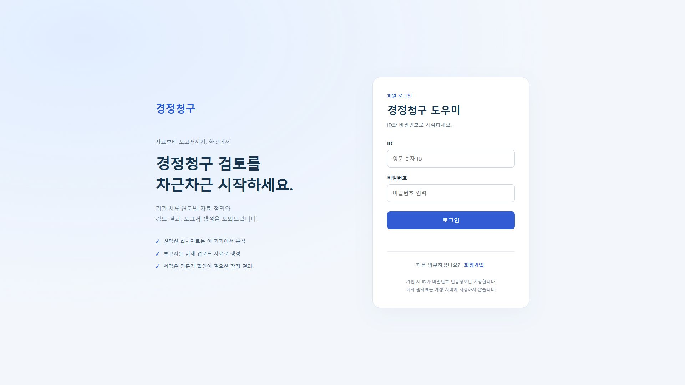
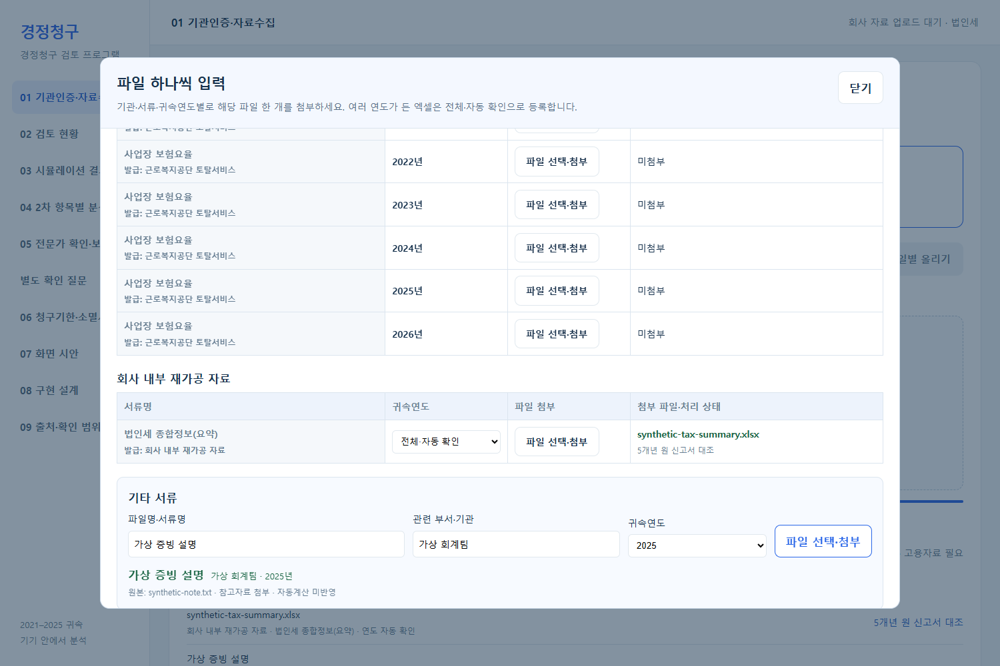
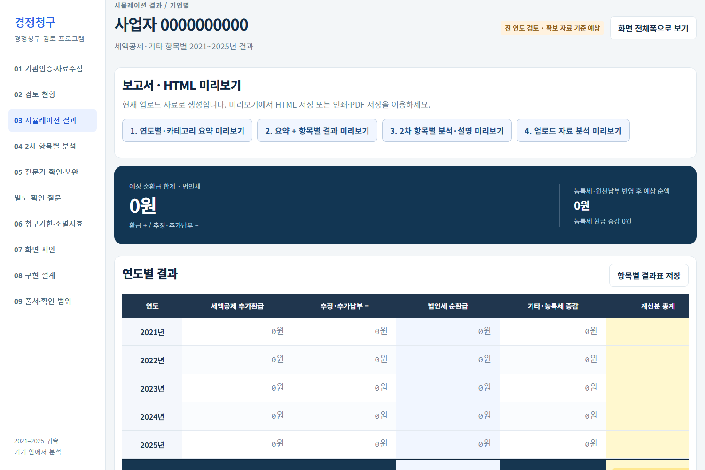
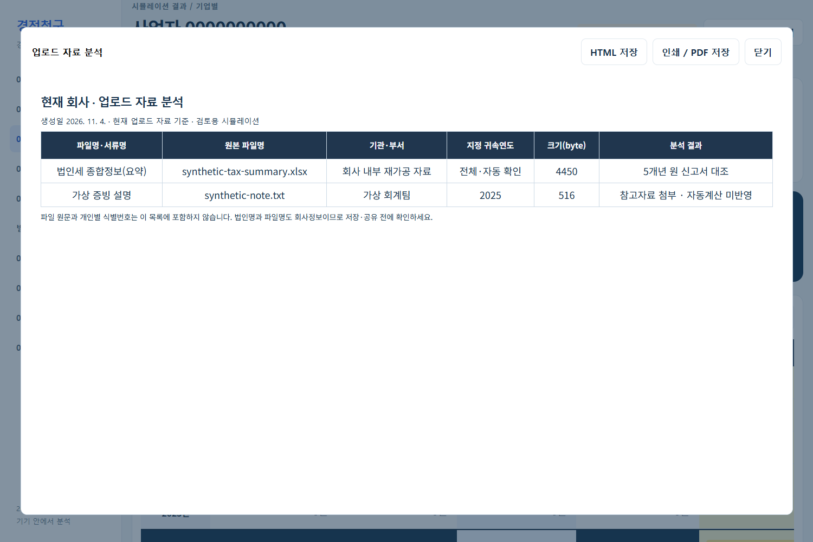

# 제출용 검증 기록

검증일: 2026-11-04. Windows의 Microsoft Edge 헤드리스 브라우저에서 로컬 `file://` 앱을 검증한 뒤, [Cloudflare 프로덕션 주소](https://tax-return-review-quest.pages.dev/)에서 같은 가상파일로 전체 검증을 다시 통과했다. 아래 캡처는 공개 배포 화면이다.

## 로그인·회원가입 추가 검증

인증 기능은 미리보기 배포와 위 프로덕션 주소에서 가상 계정으로 검증했다. 비밀번호는 메모리에서만 사용했고 저장·공개하지 않았다.

| 항목 | 실제 확인한 결과 |
|---|---|
| ID/PW 진입 | 비로그인 앱 직접 접근은 로그인 화면으로 이동, 틀린 비밀번호 거부, 새 ID/PW 재로그인 성공 |
| 회원가입 | 확인 비밀번호 불일치 차단, 중복 ID 거부, 정상 계정 생성 |
| 2~3분 가입 팝업 | 브라우저 가상 시계에서119초에는 닫힘,180초 이내 자동 열림. 실제3분을 기다린 영상 검증은 아님 |
| 10초 후 자동 로그인 | 실제10초 이상 대기 후 앱 진입, 서버도10초 이전 로그인 시도를425로 거부 |
| 세션 | Secure·HttpOnly·SameSite=Lax 쿠키 확인, 새로고침·Reset 후 인증 유지 |
| 요청 보호 | 다른 Origin의 로그아웃 요청403 거부 |
| 로그인 후 기존 기능 | 가상5개년 XLSX 반영, 보고서1~4의 HTML 다운로드 성공, JavaScript 오류 없음 |
| 로그아웃 | 세션 종료 후 앱 직접 접근 차단 |
| 기존 회귀검증 | Node 회귀 테스트16개 통과 |

현재 배포 인증 검증 명령은 `python dev/tests/auth_qa.py --url https://tax-return-review-quest.pages.dev`다. 이 명령은 임시 가상 계정을 생성하므로 검증 후 `dev/build/auth-qa/account.json`에 기록된 **정확한 테스트 ID에 해당하는 계정·세션만** 관리자 DB 작업으로 정리한다. 실제 회원을 일괄 삭제하지 않는다. 로컬 업로드 전용 회귀검증은 `python dev/tests/submission_demo_qa.py`로 실행한다.

## 이번에 확인한 결과

| 항목 | 결과·근거 |
|---|---|
| 빈 화면 시작 | 기본 회사·과거 업로드 없이 시작 |
| 개별 입력 | 기관·서류·연도별 18칸 존재, 요약 XLSX를 지정 칸에 첨부 |
| 수치 대조 | 가상 식별값 `0000000000`, 2021~2025년 과세표준·부담세액 모두 샘플 원본과 일치 |
| 기타 첨부 | ‘가상 증빙 설명’·‘가상 회계팀’·2025년으로 TXT 첨부, 오류 없음 |
| 결과표 | 5개 연도와 합계 행 생성; 고용자료 미첨부 유지 |
| 보고서·저장 | 보고서 1~4 모두 열림, 각 HTML 다운로드 파일 생성 확인 |
| 원자료 목록 | 보고서4에 두 파일명·직접 입력한 이름·부서·연도 표시 |
| 회사 혼합 방지 | 파서가 다른 가상 회사번호를 반환하도록 바꾼 시험에서 거부, 기존 수치 유지. 별도 실제 회사 파일을 사용한 시험은 아님 |
| 초기화 | Reset 후 빈 화면·첨부 0개; 브라우저 JavaScript 오류 없음 |
| 공개자료 검사 | 비공개 식별문자열을 이용한 현재 파일·전체 Git 객체 점검 통과. 식별문자열 목록은 공개하지 않음 |

아래는 로그인 추가 전부터 확인한 입력·보고서 검증이다. 실행 로그·가상 보고서 다운로드는 Git 제외 경로인 `dev/build/submission/`과 `dev/build/auth-qa/`에 생성된다. 공개 XLSX는 SHA-256 `079d2a7d7979cae31b276501a462e3aa00a78705df542addbbb300f57f3df14a`의 한 파일만 허용한다. 재생성하면 해시가 달라질 수 있으므로 내용을 검토한 뒤 검사 도구의 예외 해시를 갱신해야 한다.

## 제출 화면

모두 가상자료 화면이며 실제 고객정보가 없다.

## 해석할 때 주의할 범위

고용·보험료 증빙이 없는 샘플로 자료정리·파일 인식·보고서 흐름을 확인했다. 화면의 0원은 실제 환급 불가 확정이나 세법상 정답을 뜻하지 않는다. 세무적 계산 정확성, 실제 기관 인증·다운로드, 연속 조작 시연 녹화는 이번 검증의 완료 항목이 아니다. 공개 배포는 GitHub Pages가 아닌 Cloudflare Pages로 완료했다.

## 실제 자료 기반 데모 개정 검증 — 2026-11-04

- 같은 원자료18개를 별도 시연 탭에서 기관·서류·연도별로 하나씩 첨부. 사용자 원래 업로드 탭은 새로고침·Reset하지 않음.
- 5/5개년 신고서와 고용110이력 반영을 확인. 원본 ZIP 입력과 개별 입력의5개년 결과가 일치.
- Q&A는 확인 필요·명세 대조 메모로 시연.2023년 이월공제 전문가 과제는 상담준비로 저장. 실제 발송·전문가 회신·확정 세액 아님.
- 14개 장면·170.02초·1920×1080·H.264/AAC. 회사는 주식회사0000 표시, 계정·문서 원문 식별정보는 화면에서 제외하고 표 수치 유지.
- 전체 디코딩 통과,0.5초 이상 검은 화면 없음. 평균 음량 −20.0dB,최대 −4.4dB로 클리핑 없음.
- 로컬 웹 플레이어 재생·일시정지·125초 이동 통과,브라우저 JavaScript 오류0건.
- 회원가입 양식은 실제 앱 UI를 로컬에서 촬영. 가입 완료·2~3분 자동 팝업·10초 카운트다운은 이번 영상에 포함하지 않음. 사용자 로그인 입력은 비공개.

## 제출 파일 정리·로그인 문구 수정

중복 바로가기·이전 스토리보드·영상 제작 원본 등53개 공개 파일을 백업 후 제거했다. 프로그램·EXE·필수 제출 문서·검증 자료·샘플·최종 영상은 유지했다. 로그인과 영상의 양식 제목은 경정청구 도우미로 통일했다. README는 데모, 실행 주소, 필수 문서 순서로 정리했다.
