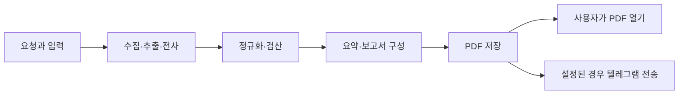

# 중소기업 AI 업무 작업실

**AIFFEL Main Quest 2 · 증빙을 찾아 보고서를 작성하는 중소기업 업무의 PoC**

재무자료, 회의 기록, 문서, 정책 공고를 분류하고 원문을 추출해 검토할 수 있는 PDF로 정리합니다. 재무 수치는 코드로 계산·검산하고, AI는 원문 요약과 설명을 맡습니다.

## 중요 링크

| 자료 | 확인할 내용 |
|---|---|
| [데모 HTML](web/demo.html) | 다운로드 후 브라우저에서 업무 8개 시연 |
| [온라인 데모](https://sme-ai-workroom-quest02.pages.dev/) | Cloudflare에 배포된 8개 업무 데모 |
| [제품 요구사항 PRD](docs/PRD.md) | 사용자, 입력·출력 범위, 검토 기준 |
| [효과 검증](#개선-효과와-판정) | 측정 조건과 180초 판정 기준 |
| [GitHub 과제 폴더](https://github.com/sorek-charlie/AIFFEL-Quest/tree/main/Quest_main_02) | 제출 위치 |
| [DART](https://dart.fss.or.kr/) · [기업마당](https://www.bizinfo.go.kr/) | 재무 공시와 지원사업 원문 사이트 |

## 데모 바로 실행

**[업무 흐름 데모 보기](https://sme-ai-workroom-quest02.pages.dev/)** · [오프라인용 데모 HTML](web/demo.html)

업무별 링크를 열면 가상 입력, 처리 단계, 결과가 자동 재생됩니다. 간략·심층·종합 데모에서는 가상 재무자료로 생성한 PDF를 내려받을 수 있습니다. 공개 데모는 설치 PC가 꺼져 있어도 열립니다.

| 업무 | 시연에서 확인할 내용 |
|---|---|
| [간략보고서](https://sme-ai-workroom-quest02.pages.dev/#brief) | 회사명 요청 → DART 공개 공시 경로 → 3개년 비교 미리보기 |
| [심층보고서](https://sme-ai-workroom-quest02.pages.dev/#deep) | 재무제표 → 손익 구조 및 원가 대조 → 누락 항목 표시 |
| [종합보고서](https://sme-ai-workroom-quest02.pages.dev/#comprehensive) | 자료 묶음 → 실적·계획 분리 → 성장 추이와 자금 활용 정리 |
| [세무조정계산서 분석보고서](https://sme-ai-workroom-quest02.pages.dev/#adjustment) | 계산서 → 금액·단위·원문 쪽 연결 → 확인 필요 항목 표시 |
| [회의록정리](https://sme-ai-workroom-quest02.pages.dev/#meeting) | 녹음 → 음성 전사 → 결정 사항과 후속 작업 |
| [요약보고서](https://sme-ai-workroom-quest02.pages.dev/#document) | 문서 → 본문 추출 → 핵심 요약과 근거 |
| [Daily News](https://sme-ai-workroom-quest02.pages.dev/#issue) | 기사 제목 수집 → 분야별 요약 → 게시 시각과 출처 |
| [정부정책 주간보고](https://sme-ai-workroom-quest02.pages.dev/#policy) | 공고 수집 → 지원 대상·마감일 → 원문 링크 |

## 문제 정의와 적용 지점

대상은 중소기업 실무자와 보고서 검토자입니다. 현재는 입력 파일을 열고, 필요한 문장이나 표를 옮기고, 출처를 다시 대조해 배포용 문서를 만듭니다. **추출·전사·요약을 한 흐름으로 연결하고 근거를 남기면, 검토와 수정까지 걸리는 시간이 줄어들 것**이라고 가정했습니다.

| 후보 | PoC에서 확인할 판단 |
|---|---|
| 재무자료 정리 | 연도·계정·단위를 검산할 수 있고, 숫자와 원문을 함께 검토할 수 있는가 |
| 회의·문서 정리 | 결정 사항·기한·근거가 보존되고, 누락된 항목을 검토자가 알아볼 수 있는가 |
| 정책 공고 선별 | 지원 대상·마감일·원문을 짧은 시간 안에 확인할 수 있는가 |

이 세 후보는 사람이 결과를 검토할 수 있고, 원문이나 공고와 대조해 판정할 수 있어 선택했습니다. 세무조정은 원문 대조와 요약까지만 다룹니다.

## 모델 선정과 실행 구조

| 구성 | 선정 이유와 역할 |
|---|---|
| PDF 텍스트 추출·Tesseract | 텍스트와 스캔을 입력 유형에 따라 처리하고 원문 위치를 추적합니다. |
| faster-whisper tiny·FFmpeg | 로컬에서 음성 전사를 실행합니다. 영상에서는 오디오를 사용합니다. |
| OpenAI API | 추출한 원문을 바탕으로 구성과 서술을 정리합니다. 실제 응답을 확인했습니다. |
| 로컬 LLM | 공개 뉴스 제목 및 정책 공고의 브리핑에 적용했습니다. |
| 결정적 재무 처리 | 연도·계정·금액·단위·근거를 코드로 정규화하고 대조합니다. 확인이 필요한 항목은 표시합니다. |



입력·재무 처리·보고서 출력·브리핑·웹 화면·검증을 역할별로 관리합니다. 보고서 양식과 근거 규칙은 업무별로 적용합니다. PDF 저장 직후 콜백으로 결과를 표시하고 발송 상태는 후속 이벤트로 갱신합니다. 위 그래프는 실행 의존 관계를 보여줍니다. MCP와 그래프 실행 엔진의 도입 여부는 추가 연결과 분기가 필요한 단계에서 검토합니다.

반복 검증은 **같은 입력 → 결과 비교 → 실패 기록 → 원인 수정 → 같은 입력으로 재검증** 순서입니다. 단계별 시간과 품질을 함께 보며 파일 재추출을 막고, PDF 열기를 외부 전송 대기와 분리했습니다.

## 개선 효과와 판정

**합격 기준은 업로드 시작부터 PDF를 열 수 있을 때까지 180초 이내이면서, 데모와 같은 수준의 구성·핵심 내용·원자료 근거를 갖추는 것입니다.** 시간과 품질 가운데 하나라도 미달하면 해당 실행은 미달로 기록합니다.

| 평가 항목 | 확인한 결과 |
|---|---|
| 추출·정규화·검산 | 동일 재무 입력, 동일 PC에서 5회 실행한 중앙값 **2,016.63ms** |
| 검산 결과 재사용 | 같은 5회의 메모리 조회·복사 중앙값 **0.583ms**, 최초 정규화 결과와 동등성 확인 |
| 실제 연동 | OpenAI 응답, DART 간략보고서 PDF 생성, 뉴스·정책 수집 및 브리핑 PDF 경로 확인 |
| 모의 업무 검증 | 재무자료 중복 추출 방지, 외부 발송 대기 중 PDF 열기, 180초 판정 경계값 확인 |
| 실제 종단 간 검증 | 복합 입력 180초 및 데모 품질 동시 충족, 수작업 대비 절감률, 예약 실행은 측정 예정 |

위 두 시간은 내부 단계의 측정값입니다. 종단 간 평가는 업로드 시작, PDF 열기 가능, 발송 완료를 각각 측정합니다. 동일한 입력으로 수작업과 PoC를 비교하고, 검토·수정 시간과 실패 유형까지 기록할 계획입니다.

## 제출 항목과 다음 단계

| 평가 항목 | 확인 위치 |
|---|---|
| 문제 정의와 개선 가설 | [대상 사용자, 적용 후보, 성공 기준](#문제-정의와-적용-지점) |
| AI 모델 선정과 실험 | [선정 이유와 역할](#모델-선정과-실행-구조) · [실제 연동 확인](#개선-효과와-판정) |
| 동작하는 PoC | [8개 시나리오와 실행 가능한 데모 소스](#데모-바로-실행) |
| 개선 효과 검증 | [측정값, 판정 기준, 미검증 항목](#개선-효과와-판정) |
| 한계와 확장 시도 | 재무 결과 재사용, PDF 선공개, 정책 수집에서 출력까지 연결, 공개 시연 |

다음 평가는 입력 유형과 난이도별로 표본을 나누고, 수작업 기준선과 비교합니다. 출처·금액·기간·단위가 불명확한 자료, 영상 화면과 자막, 예약 실행을 각각 검증합니다. 정책 브리핑은 지원 대상과 신청 마감일을 공식 공고에서 확인할 수 있도록 원문 링크를 보존합니다.

공개 데모의 모든 입력과 내용은 가상입니다. 실제 실행에서 자료 추출은 PC에서 진행하고, OpenAI를 선택한 업무는 필요한 추출 텍스트를 API로 보냅니다. 텔레그램 전송은 설정된 경로에서 별도로 실행됩니다.

## Windows에서 실제 실행

Python 3.11, FFmpeg, Tesseract 및 한국어·영어 언어 데이터를 설치한 뒤 프로젝트 루트에서 실행합니다.

```powershell
python -m venv .venv
.\.venv\Scripts\python.exe -m pip install -r requirements.txt
.\.venv\Scripts\python.exe -c "from huggingface_hub import snapshot_download; snapshot_download('Systran/faster-whisper-tiny', local_dir='models/whisper-tiny')"
.\.venv\Scripts\python.exe -m app.server
```

[로컬 업무 작업실](http://127.0.0.1:8765/)을 엽니다. [AI 키 설정](AI_API_키_설정.cmd)으로 키를 로컬에 저장할 수 있습니다. 환경변수 목록은 [환경변수 예시](.env.example)에 있습니다. 회의록과 요약은 PC에서 원문을 추출한 뒤 선택한 AI 서비스에 원문을 보냅니다. 웹은 문서·이미지 25MB, 음성·영상 200MB, 텔레그램은 파일당 20MB까지 처리합니다. 영상은 음성 전사 범위를 처리합니다.

### 텔레그램 연결

- 새 개인 봇을 운영하는 환경은 `TELEGRAM_BOT_TOKEN`, `TELEGRAM_CHAT_ID`, `TELEGRAM_USER_ID`를 설정해 웹 서버를 시작합니다.
- 같은 봇을 이미 Hermes에서 운영하는 환경은 [Hermes 연결 설치 스크립트](scripts/install_hermes_workroom.py)에 Hermes 홈 경로를 전달해 연결한 뒤 게이트웨이를 다시 시작합니다. 같은 토큰의 수신기를 두 개 실행하면 Telegram이 수신 충돌을 반환합니다.
- 간략보고서는 DART 공개 사업보고서의 연간 비교 재무표를 사용하며 연결·별도 기준과 공시 출처를 표시합니다. 회사명이 중복되거나 단위·기간을 읽을 수 없는 공시는 처리 결과를 보류합니다.
- 심층·종합은 계정·연도·금액 단위가 확인되는 PDF·엑셀·CSV·ZIP을 사용합니다. 세무조정 분석은 텍스트형 PDF의 금액과 출처 쪽을 정리하며, 신고용 세액 확정이나 신고 접수는 지원 범위 밖입니다.
- 생성된 파일은 `data/artifacts/`에 저장됩니다. 결과 로그에서 텔레그램 전송 확인을 볼 수 있습니다.

### 검증 상태

- 2026-11-18 OpenAI API의 실제 응답을 확인했습니다. Claude는 API 키가 미설정입니다.
- DART 공시를 조회해 간략보고서 양식으로 PDF를 생성하고 개인 텔레그램에 전송했습니다.
- 개인 텔레그램에서 회사명만 입력해 간략 PDF 수신을 확인했습니다. 가상 첨부로 심층·종합·세무조정 분석·회의록정리·요약보고서 PDF 수신도 확인했습니다.
- Daily News와 정부정책은 실제 수집, 로컬 AI 요약, PDF 발송을 각각 한 차례 확인했습니다. 뉴스 입력은 기사 제목이며 정책은 기업마당·K-Startup·판판대로·정부24를 사용합니다. 예약 시각 실행과 업무 시간 단축은 별도 측정 대상입니다.
- 131MB 예제 영상의 음성 전사와 구간별 진행률을 로컬에서 확인했습니다.

## 프로젝트 자료

- [제품 범위](PRODUCT.md) · [PRD](docs/PRD.md) · [디자인 기준](DESIGN.md)
- [문제 정의 및 평가](docs/문제정의_및_평가.md) · [간략보고서 양식](docs/간략보고서_분석.md) · [심층분석 양식](docs/심층분석_양식.md)
- [정기 브리핑 구성](docs/정기_브리핑.md) · [정책 수집과 예약](docs/정책공고_API_확인.md) · [로컬 LLM 사양](docs/로컬_LLM_사양.md)
- [예시 재무 CSV](examples/finance-demo.csv) · [예시 회의록 원문](examples/meeting.txt) · [예시 정책 JSON](examples/policy.json) · [예시 뉴스 JSON](examples/issue.json)
- 자동 테스트는 프로젝트 루트에서 `python -m unittest discover -s tests -v`로 실행합니다. 브라우저 테스트 도구가 있으면 [화면 검사](scripts/check_ui.py)를 실행할 수 있습니다. 로컬 데모 자료가 필요한 브라우저 테스트는 해당 PC에서 실행합니다.

실제 회사 원본, 계정과 대화 기록, 발송 파일, API 키, 모델 및 실행 파일은 공개 저장소에서 제외합니다.
GitHub 제출 ZIP은 `python scripts/build_submission.py`로 만들 수 있습니다.
