# 중소기업 AI 업무 작업실

**AIFFEL Main Quest 2 · 증빙을 찾아 보고서를 작성하는 중소기업 업무의 PoC**

재무자료, 회의 기록, 문서, 정책 공고를 분류하고 원문을 추출해 검토할 수 있는 PDF로 정리합니다. 재무 수치는 코드로 계산·검산하고, AI는 원문 요약과 설명을 맡습니다.

웹 작업실은 재무분석, 회의록정리, 요약보고서, Daily News, 정부정책 다섯 업무를 제공합니다. 재무분석의 네 보고서 유형을 포함해 여덟 가지 업무 결과를 화면에서 볼 수 있습니다.

## 제출 자료와 실행 방법

1. [시연영상](https://github.com/sorek-charlie/AIFFEL-Quest/blob/main/Quest_main_02/docs/assets/workroom-walkthrough.mp4)에서 `업무작업실.exe`를 실행해 8개 업무를 하나씩 누르는 과정을 확인합니다.
2. [작업실 화면](https://sme-ai-workroom-quest02.pages.dev/)에서 실행파일과 같은 화면을 직접 눌러 봅니다. 메뉴를 누르면 `데모자료` 폴더의 결과가 표시됩니다.
3. PC에서 자체 자료로 실행하려면 [Windows에서 실제 실행](#windows에서-실제-실행)을 참고합니다. AI 연결과 텔레그램 전송은 해당 서비스 설정이 필요합니다.

| 자료 | 확인할 내용 |
|---|---|
| [시연영상](https://github.com/sorek-charlie/AIFFEL-Quest/blob/main/Quest_main_02/docs/assets/workroom-walkthrough.mp4) | `업무작업실.exe` 홈 → 8개 업무 클릭 → 데모자료 결과 확대 보기 (85초) |
| [작업실 화면](https://sme-ai-workroom-quest02.pages.dev/) | 업무작업실.exe와 같은 홈·작업실 화면. 버튼을 누르면 데모자료 결과 표시 |
| [프로그램 실행 화면](#프로그램-실행-화면) | 작업실 화면에 표시되는 업무별 결과 8개 |
| [제품 요구사항 PRD](docs/PRD.md) | 사용자, 입력·출력 범위, 검토 기준 |
| [효과 검증](#개선-효과와-판정) | 측정 조건과 180초 판정 기준 |
| [주요 산출물 이미지](#주요-산출물-이미지) | 가상 재무 PDF와 업무별 결과 화면 |
| [프로그램 구조](#프로그램-구조) | 입력, AI·검산, 저장, 텔레그램 전달 |
| [GitHub 과제 폴더](https://github.com/sorek-charlie/AIFFEL-Quest/tree/main/Quest_main_02) | 제출 위치 |
| [DART](https://dart.fss.or.kr/) · [기업마당](https://www.bizinfo.go.kr/) | 재무 공시와 지원사업 원문 사이트 |

## 시연영상

[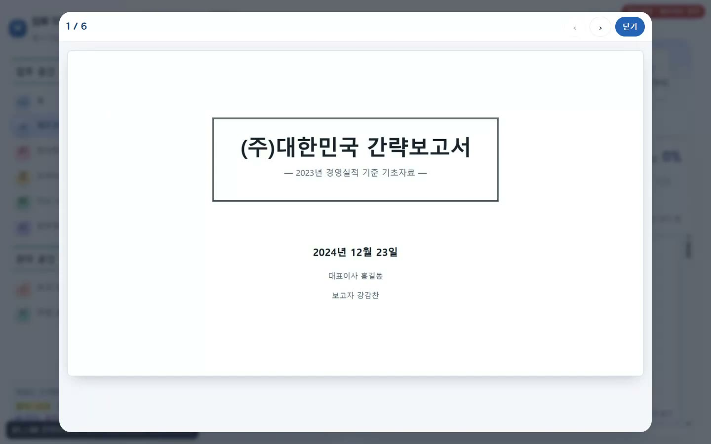](https://github.com/sorek-charlie/AIFFEL-Quest/blob/main/Quest_main_02/docs/assets/workroom-walkthrough.mp4)

**[시연영상 재생 (85초, MP4)](https://github.com/sorek-charlie/AIFFEL-Quest/blob/main/Quest_main_02/docs/assets/workroom-walkthrough.mp4)** · **[시연영상 다운로드 (7.6MB)](https://github.com/sorek-charlie/AIFFEL-Quest/raw/main/Quest_main_02/docs/assets/workroom-walkthrough.mp4)** · [저장소의 영상 파일](docs/assets/workroom-walkthrough.mp4)

`dist\업무작업실.exe`를 실행한 뒤 Chrome 창에서 홈 → 재무분석(간략·심층·종합·세무조정계산서) → 회의록정리(데모버전_01·02) → 요약보고서 → 이슈 브리핑(Daily News) → 정부정책 순서로 클릭하고, 각 결과를 크게 열어 쪽을 넘깁니다. 화면 오른쪽 위의 `데모버전 · 데모자료 결과`와 아래쪽 자막은 녹화용 표시입니다.

| 순서 | 업무 | 결과 출처 |
|---|---|---|
| 01–04 | 재무분석 4종 | `데모자료/01-1.간략보고서` ~ `01_4.세무조정계산서` |
| 05 | 회의록정리 | `데모자료/02.회의록정리` |
| 06 | 요약보고서 | `데모자료/03.요약보고서` |
| 07 | Daily News | `데모자료/04.Daily News` |
| 08 | 정부정책 | `데모자료/05.정부정책` |

영상의 결과는 모두 `데모자료` 폴더의 예시 결과이며, 녹화 중에는 유료 AI 호출·파일 생성·텔레그램 발송을 하지 않았습니다. 이 PC의 실제 텔레그램 발송 기록 대신 데모자료 결과가 보이도록 발송 기록 조회만 빈 목록으로 응답합니다.

### 같은 화면을 브라우저에서 열기

**[작업실 화면 열기](https://sme-ai-workroom-quest02.pages.dev/)**

외부 URL은 `업무작업실.exe`가 여는 홈과 작업실 화면(`web/landing.html`, `web/index.html`)을 덧붙인 표시 없이 그대로 씁니다. 시연영상과 같은 조건으로 발송 기록은 빈 목록이므로, 어떤 업무 버튼을 눌러도 실행파일과 같은 `데모자료` 결과가 열립니다. 분석·수집·텔레그램 발송 버튼은 실행되지 않고 실행파일에서 실행하라는 안내를 표시합니다. 설치 PC가 꺼져 있어도 열립니다.

### 시연영상 다시 녹화하기

```powershell
.\.venv\Scripts\python.exe -m scripts.exe_walkthrough            # 화면에서 시연
.\.venv\Scripts\python.exe -m scripts.exe_walkthrough --record   # 시연하면서 MP4로 저장
```

`dist\업무작업실.exe`가 꺼져 있으면 먼저 실행합니다. `--pages N`으로 결과마다 넘길 쪽 수(기본 5)를, `--pause 1.5`로 속도를 조절합니다. 녹화 파일은 `output/exe-walkthrough/exe-walkthrough.mp4`에 저장되며, `docs/assets/workroom-walkthrough.mp4`로 복사하면 README와 외부 URL에 반영됩니다. `dist`의 EXE는 로컬 빌드 산출물이며, 소스 ZIP에서는 `.\.venv\Scripts\python.exe -m scripts.launcher`를 사용합니다.

외부 URL 사이트는 `python -m scripts.build_public_workroom`으로 만들고 Cloudflare Pages에 배포합니다.

## 프로그램 실행 화면

실제 작업실 화면에서 업무별 데모자료 결과가 표시된 모습을 캡처했습니다. 모든 결과와 발송 내역은 공개용 가상 자료입니다. 이미지를 누르면 원본 크기로 열립니다.

| 간략보고서 | 심층보고서 |
|---|---|
| [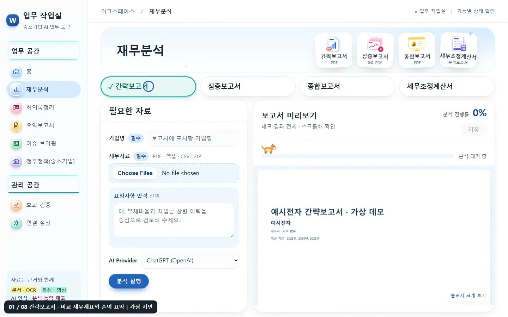](docs/assets/workroom-brief.jpg) | [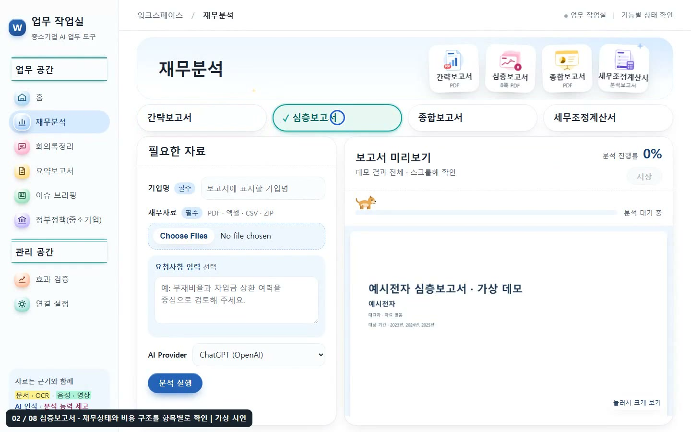](docs/assets/workroom-deep.jpg) |

| 종합보고서 | 세무조정계산서 |
|---|---|
| [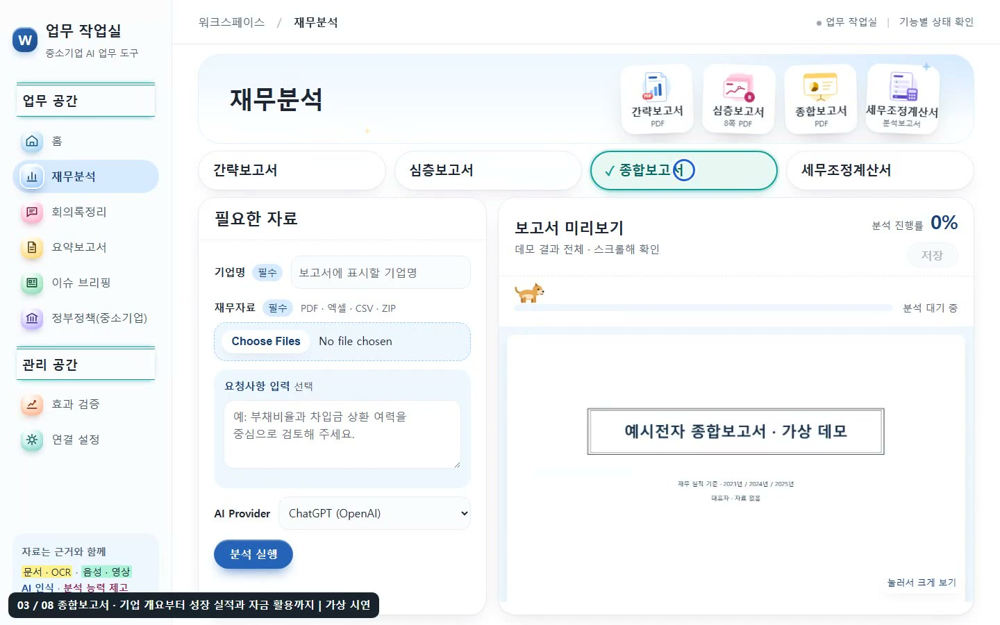](docs/assets/workroom-comprehensive.jpg) | [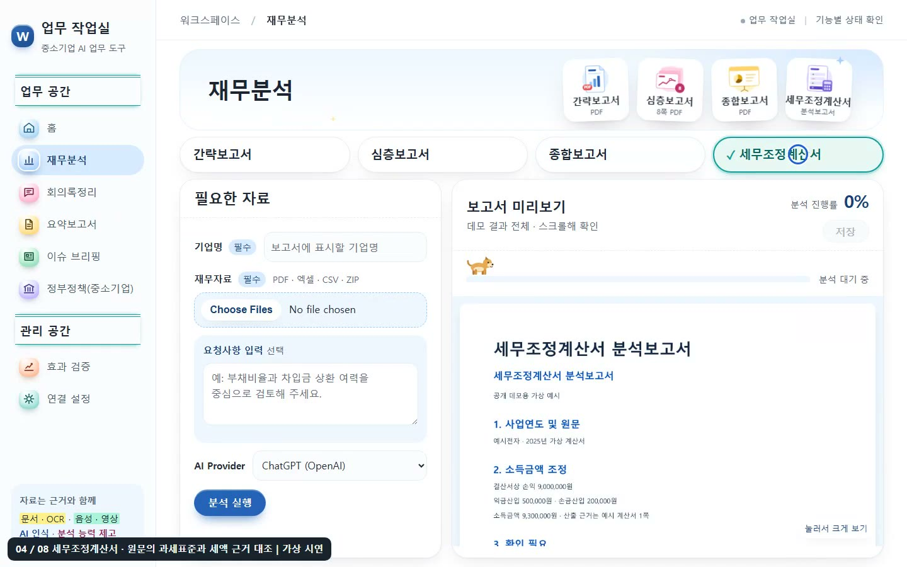](docs/assets/workroom-adjustment.jpg) |

| 회의록정리 | 요약보고서 |
|---|---|
| [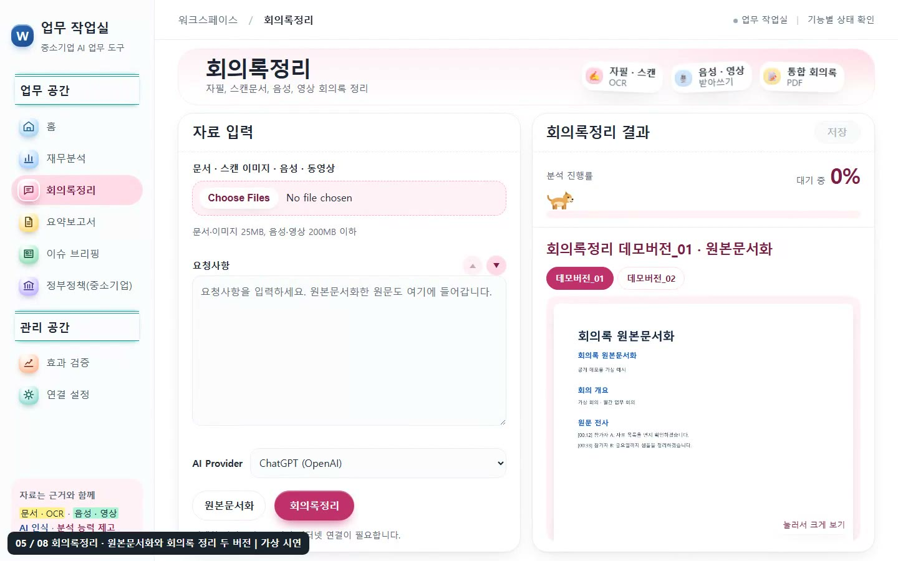](docs/assets/workroom-meeting.jpg) | [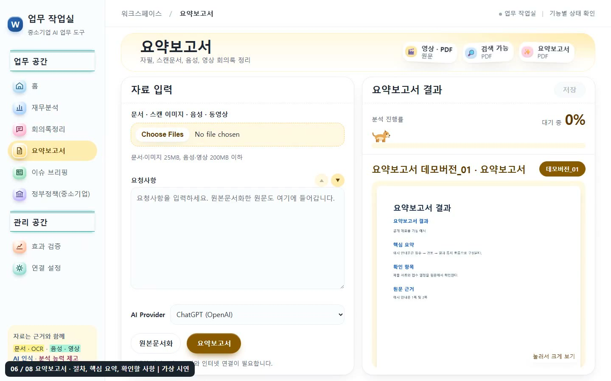](docs/assets/workroom-document.jpg) |

| Daily News | 정부정책 |
|---|---|
| [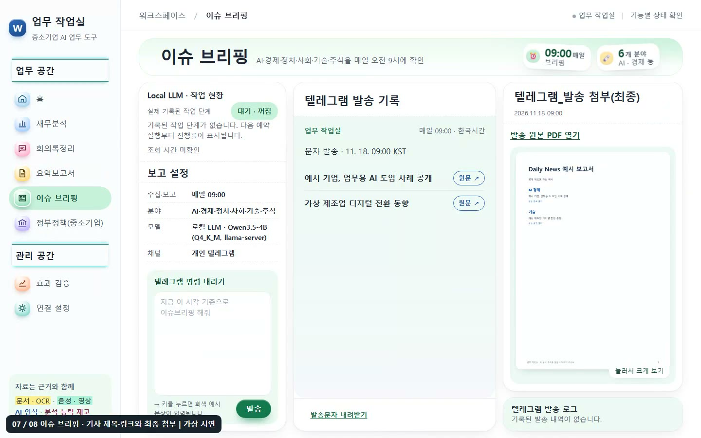](docs/assets/workroom-issue.jpg) | [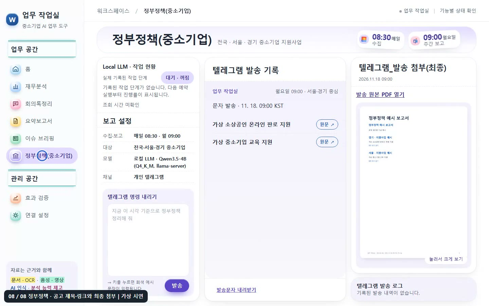](docs/assets/workroom-policy.jpg) |

## 문제 정의와 적용 지점

대상은 중소기업 실무자와 보고서 검토자입니다. 현재는 입력 파일을 열고, 필요한 문장이나 표를 옮기고, 출처를 다시 대조해 배포용 문서를 만듭니다. **추출·전사·요약을 한 흐름으로 연결하고 근거를 남기면, 검토와 수정까지 걸리는 시간이 줄어들 것**이라고 가정했습니다.

| 후보 | PoC에서 확인할 판단 |
|---|---|
| 재무자료 정리 | 연도·계정·단위를 검산할 수 있고, 숫자와 원문을 함께 검토할 수 있는가 |
| 회의·문서 정리 | 결정 사항·기한·근거가 보존되고, 누락된 항목을 검토자가 알아볼 수 있는가 |
| 정책 공고 선별 | 지원 대상·마감일·원문을 짧은 시간 안에 확인할 수 있는가 |

이 세 후보는 사람이 결과를 검토할 수 있고, 원문이나 공고와 대조해 판정할 수 있어 선택했습니다. 세무조정은 원문 대조와 요약까지만 다룹니다.

노드09의 업무 유형으로 보면 스캔 OCR과 음성 STT는 **입력·전사**, 기사·공고 수집과 원문 연결은 **검색**, 회의의 결정·후속 작업과 정책의 지역별 정리는 **분류·배분**, 재무 계정과 합계 대조는 **검사·판독**에 해당합니다. 원문 위치나 기간·단위를 확인할 수 없는 항목은 검토 대상으로 남깁니다. 신청 자격, 신고 세액, 대외 제출의 최종 판단은 담당자가 맡습니다.

## 모델 선정과 실행 구조

| 구성 | 선정 이유와 역할 |
|---|---|
| PDF 텍스트 추출·Tesseract | 텍스트와 스캔을 입력 유형에 따라 처리하고 원문 위치를 추적합니다. |
| faster-whisper tiny·FFmpeg | 로컬에서 음성 전사를 실행합니다. 영상에서는 오디오를 사용합니다. |
| OpenAI API | 추출한 원문을 바탕으로 구성과 서술을 정리합니다. 실제 응답을 확인했습니다. |
| 로컬 LLM | 공개 뉴스 제목 및 정책 공고의 브리핑에 적용했습니다. |
| 결정적 재무 처리 | 연도·계정·금액·단위·근거를 코드로 정규화하고 대조합니다. 확인이 필요한 항목은 표시합니다. |

후보 비교의 기준선은 사람이 직접 작성하고 검토하는 방식입니다. OCR·STT까지만 적용하는 후보는 원문을 로컬에서 텍스트로 바꾸고 사람이 구조화합니다. 여기에 외부 LLM을 연결하면 요약 초안을 얻을 수 있고, 정기 공개자료 브리핑에는 로컬 LLM을 사용합니다. 세 후보의 동일 입력 비교는 미측정입니다. 외부 반출 허용과 모델·자료 라이선스는 성능 평가 전에 확인할 조건입니다. 실험에는 반출 승인 자료 또는 가상 자료를 사용합니다.

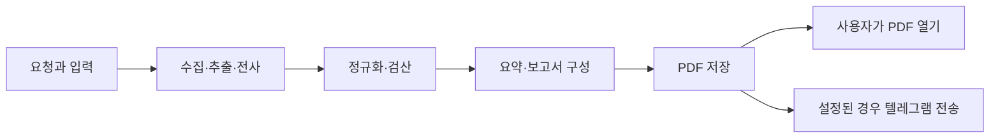

입력·재무 처리·보고서 출력·브리핑·웹 화면·검증을 역할별로 관리합니다. 보고서 양식과 근거 규칙은 업무별로 적용합니다. PDF 저장 직후 콜백으로 결과를 표시하고 발송 상태는 후속 이벤트로 갱신합니다. 위 그래프는 실행 의존 관계를 보여줍니다. MCP와 그래프 실행 엔진의 도입 여부는 추가 연결과 분기가 필요한 단계에서 검토합니다.

반복 검증은 **같은 입력 → 결과 비교 → 실패 기록 → 원인 수정 → 같은 입력으로 재검증** 순서입니다. 단계별 시간과 품질을 함께 보며 파일 재추출을 막고, PDF 열기를 외부 전송 대기와 분리했습니다.

### 프로그램 구조

| 경로 | 책임과 데이터 흐름 |
|---|---|
| [web/](web/) | HTML·CSS·JavaScript 작업 화면에서 입력, 진행 상태, 결과와 전달 상태를 표시합니다. `demo.html`은 가상 시나리오를 재생하는 독립 HTML입니다. |
| [app/server.py](app/server.py) · [app/ingest.py](app/ingest.py) | 로컬 HTTP 서버가 업로드를 받아 처리 유형을 선택합니다. PDF 텍스트, OCR, 음성 전사를 업무별 처리 흐름에 넘깁니다. |
| [app/finance_input.py](app/finance_input.py) · [app/finance_review.py](app/finance_review.py) · [app/finance_reports.py](app/finance_reports.py) | 재무 원자료를 계정·기간·단위별로 정규화하고 합계를 대조합니다. 검산 식별자로 결과를 재사용하고, 검산 불일치 시 생성을 중단합니다. |
| [app/providers.py](app/providers.py) · [app/searchable_pdf.py](app/searchable_pdf.py) | 선택한 공급자에 업무 텍스트를 전달합니다. 스캔 원본은 텍스트를 검색할 수 있는 PDF로 만들고, 요약은 별도 결과로 제공합니다. |
| [app/output_delivery.py](app/output_delivery.py) · [app/telegram_gateway.py](app/telegram_gateway.py) | PDF 저장을 먼저 알리고 Telegram 응답을 후속 상태로 기록합니다. 설정된 수신 경로로 결과를 전달합니다. |
| [briefings/](briefings/) · [scripts/](scripts/) | 뉴스와 공고 수집, 로컬 모델 검토, PDF 렌더링, 발송 기록, Windows 예약 작업 및 공개 제출 패키지를 담당합니다. |
| [examples/](examples/) · [tests/](tests/) | 가상 입력과 로컬 회귀 테스트를 제공합니다. [구조와 운영 도구](docs/구조와_운영도구.md)에서 상태와 의존 관계를 더 자세히 볼 수 있습니다. |

정부정책은 한국시간 매일 08:30 수집 후 월요일 09:00 발송하도록 설계했습니다. Daily News는 매일 09:00입니다. 운영 점검은 출처·신청기간·원문 링크와 수집 상태를 확인합니다. 전송 결과가 불명확할 때는 자동으로 중복 발송하지 않습니다. 참고 노트의 3회 재시도, 월 예산 상한, 미리보기 승인 절차는 운영 설계 후보입니다. [정기 브리핑](docs/정기_브리핑.md)

### 주요 산출물 이미지

아래 이미지는 [가상 재무 입력](examples/finance-demo.csv)을 로컬 코드로 처리해 생성한 PDF에서 뽑은 페이지입니다.

| 간략보고서 | 심층보고서 | 종합보고서 |
|---|---|---|
| [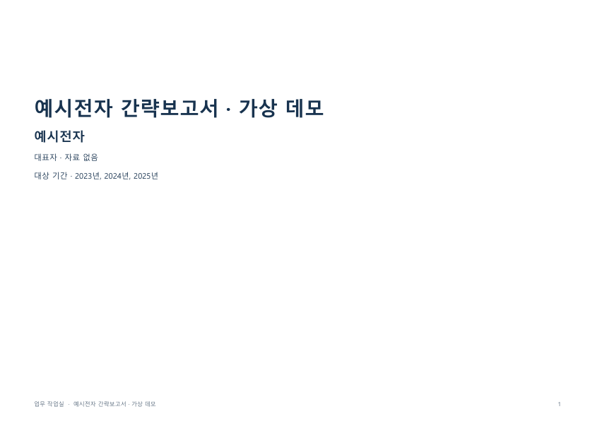](docs/assets/brief-sample.png) | [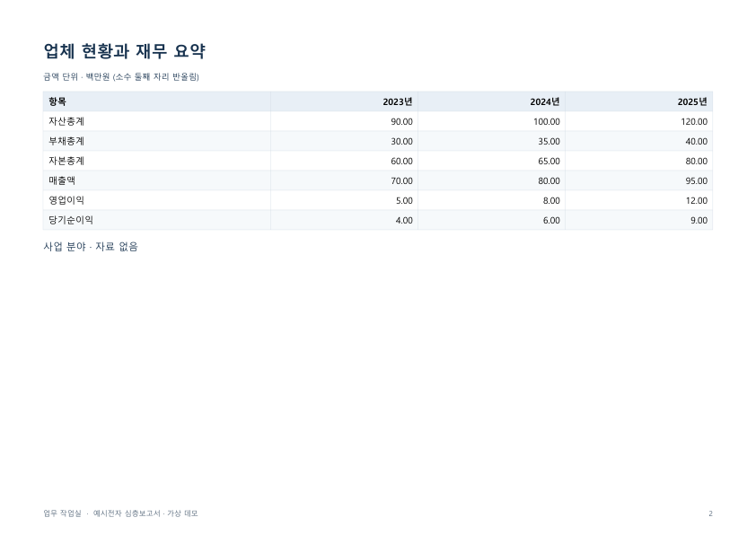](docs/assets/deep-sample.png) | [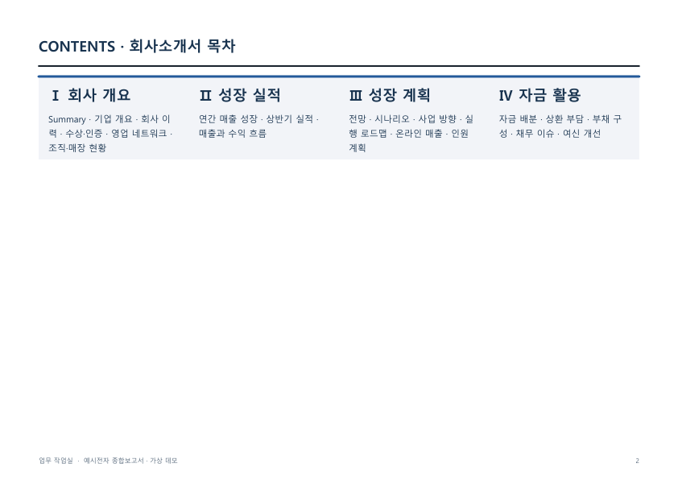](docs/assets/comprehensive-sample.png) |

가상 시나리오의 결과 화면도 열 수 있습니다. [세무조정계산서](docs/assets/adjustment-demo.png) · [회의록정리](docs/assets/meeting-demo.png) · [요약보고서](docs/assets/document-demo.png) · [Daily News](docs/assets/issue-demo.png) · [정부정책](docs/assets/policy-demo.png)

## 개선 효과와 판정

**합격 기준은 업로드 시작부터 PDF를 열 수 있을 때까지 180초 이내이면서, 데모와 같은 수준의 구성·핵심 내용·원자료 근거를 갖추는 것입니다.** 시간과 품질 가운데 하나라도 미달하면 해당 실행은 미달로 기록합니다.

| 평가 항목 | 확인한 결과 |
|---|---|
| 추출·정규화·검산 | 동일 재무 입력, 동일 PC에서 5회 실행한 중앙값 **2,016.63ms** |
| 검산 결과 재사용 | 같은 5회의 메모리 조회·복사 중앙값 **0.583ms**, 최초 정규화 결과와 동등성 확인 |
| 실제 연동 | OpenAI 응답, DART 간략보고서 PDF 생성, 뉴스·정책 수집 및 브리핑 PDF 경로 확인 |
| 모의 업무 검증 | 재무자료 중복 추출 방지, 외부 발송 대기 중 PDF 열기, 180초 판정 경계값 확인 |
| 실제 종단 간 검증 | 복합 입력 180초 및 데모 품질 동시 충족, 수작업 대비 절감률, 예약 실행은 측정 예정 |

위 두 시간은 내부 단계의 측정값입니다. 종단 간 평가는 업로드 시작, PDF 열기 가능, 발송 완료를 각각 측정합니다. 동일한 입력으로 수작업과 PoC를 비교하고, 검토·수정 시간과 실패 유형까지 기록할 계획입니다.

### 제출 전 Q 테스트 (2026-11-18)

| 확인 항목 | 결과 |
|---|---|
| Python 자동 테스트 | Windows 사용자 환경에서 62개 통과. 샌드박스의 첫 실행에서는 DPAPI 암호화 테스트에 오류가 있었고 사용자 환경에서 재실행해 통과했습니다. |
| 재무·문서 브라우저 회귀 | Chrome과 모의 API 응답으로 보고서 선택, 진행률, PDF 다운로드, 다중 파일, 원본별 검색 PDF 및 요약 PDF 경로를 확인했습니다. |
| 공개용 HTML 시나리오 | Chrome에서 8개 시나리오의 완료 결과, 스크립트 오류 및 화면 너비를 1440px·390px에서 확인했습니다. |
| 가상 재무 산출물 | 동일 가상 CSV에서 간략 7쪽, 심층 8쪽, 종합 26쪽 PDF를 생성했습니다. |
| 공개 링크 | Cloudflare 작업실 화면과 과제 제출 폼이 각각 HTTP 200을 반환했습니다. |

이번 Q 테스트는 유료 모델 호출, 실제 Telegram 발송, 예약 실행과 수작업 대비 효과를 새로 측정하지 않았습니다. 아래 Windows 실행 절의 연동 실적은 기존 운영 기록을 기준으로 합니다.

### 2026-11-18 변경 사항

| 항목 | 내용 | 확인 |
|---|---|---|
| Daily News 텔레그램 문자 | PDF와 함께 `[Daily News] 일시 기준` 머리말, 로컬 AI 메모, 분야별 상위 2건 기사를 문자로 보냅니다. 링크는 기사 제목에 걸고 주소는 표시하지 않습니다. 정부정책 문자도 같은 방식입니다. 4,000자(UTF-16) 이하로 자릅니다. | 단위 테스트와 실제 보고서 입력의 메시지 생성 확인. 새 형식의 실제 Telegram 수신은 미확인 |
| 텔레그램 발송 기록 | 기사 1건을 한 줄로 표시하고 제목을 누르면 원문이 열립니다. | Playwright 1440px·1100px·390px |
| 텔레그램 발송 로그 | 최신 기록이 맨 위에 쌓이고 30건을 넘으면 가장 오래된 기록부터 빠집니다(선입선출). 로그는 가운데 열에 있습니다. | 단위 테스트, Playwright |
| 보고 화면 배치 | 데스크톱에서 1·2열의 너비 배분 가중치를 각각 10% 낮추고 3열은 20% 높였습니다. 첨부 PDF는 패널 너비에 맞춰 표시하고 세로로 넘겨 봅니다. | Playwright에서 가상 첨부로 확인 |
| 진행률 표시 | 뉴스 수집 단계도 시작 시 0%부터 진행률 강아지를 표시합니다. | Playwright 스크린샷 |
| 제출 패키지 | `app/server.py`가 불러오는 스크립트와 README가 참조하는 문서·이미지를 공개 허용 목록에 추가했습니다. | 압축을 푼 패키지에서 테스트 62개 통과 |

`docs/assets/`의 실행 화면은 위 변경 이전에 촬영한 가상 시연 화면입니다.

## 제출 항목과 다음 단계

과제 안내문 기준으로 GitHub에 문제 정의서, 모델 선정 근거를 포함한 PoC 코드, 기존 방식과의 비교 및 실패 사례, 실행법과 결과 이미지가 있는 README를 제출합니다. 제출 폼에는 GitHub 저장소 URL을 넣고, 배포한 경우 접속 가능한 데모 URL을 추가할 수 있습니다. [AIFFEL 과제 제출 폼](https://forms.gle/82gAucMznVLXUbfD9)

| 평가 항목 | 확인 위치 |
|---|---|
| 문제 정의와 개선 가설 | [대상 사용자, 적용 후보, 성공 기준](#문제-정의와-적용-지점) |
| AI 모델 선정과 실험 | [선정 이유와 역할](#모델-선정과-실행-구조) · [실제 연동 확인](#개선-효과와-판정) |
| 동작하는 PoC | [시연영상과 실행파일과 같은 작업실 화면](#시연영상) |
| 개선 효과 검증 | [측정값, 판정 기준, 미검증 항목](#개선-효과와-판정) |
| 한계와 확장 시도 | 재무 결과 재사용, PDF 선공개, 정책 수집에서 출력까지 연결, 공개 시연 |

다음 평가는 입력 유형과 난이도별로 표본을 나누고, 수작업 기준선과 비교합니다. 출처·금액·기간·단위가 불명확한 자료, 영상 화면과 자막, 예약 실행을 각각 검증합니다. 정책 브리핑은 지원 대상과 신청 마감일을 공식 공고에서 확인할 수 있도록 원문 링크를 보존합니다.

실패 사례는 기술 오류와 출력 품질로 나눠 봅니다. 재무는 단위·기간을 식별하지 못하거나 합계가 어긋나면 자료를 다시 확인합니다. 뉴스 제목만 읽는 경로에서는 실제 점검 중 조사 결과를 넓게 일반화한 문장이 발견됐습니다. 품질 평가에서는 오류·누락과 추정이 들어간 문장을 원문과 대조합니다. 같은 자료 10~20건에 정답을 먼저 작성하고, 난도가 높은 항목을 포함해 수작업·추출만·추출과 모델을 비교할 계획입니다. 현재 수작업 기준선과 종단 간 도입 효과는 미측정입니다.

### 외부 자료

- 재무 공시 및 정책 원문은 공식 사이트에서 확인합니다. [DART](https://dart.fss.or.kr/) · [기업마당](https://www.bizinfo.go.kr/) · [K-Startup 공고 API](https://www.data.go.kr/data/15125364/openapi.do) · [판판대로 지원사업 API](https://www.data.go.kr/data/15163956/openapi.do) · [정부24 혜택 API](https://www.data.go.kr/data/15113968/openapi.do)
- 과제 기준은 Main Quest 2 안내문 2쪽, 업무 병목과 후보 비교는 노드09 강의 14쪽 및 정리노트 5쪽, 정기 정책봇의 운영 설계는 정책봇·루프 정리노트 3쪽을 참고했습니다. [AIFFEL 노드09](https://aic-data.aiffel.io/curriculum/02-ai-understanding?n=8&course_id=272db749-07c1-449c-9cb4-4d7508a855ba#lesson)

외부 URL 작업실 화면과 시연영상의 모든 입력과 결과는 가상입니다. 실제 실행에서 자료 추출은 PC에서 진행하고, OpenAI를 선택한 업무는 필요한 추출 텍스트를 API로 보냅니다. 텔레그램 전송은 설정된 경로에서 별도로 실행됩니다.

## Windows에서 실제 실행

Python 3.11, FFmpeg, Tesseract 및 한국어·영어 언어 데이터를 설치한 뒤 프로젝트 루트에서 실행합니다.

```powershell
python -m venv .venv
.\.venv\Scripts\python.exe -m pip install -r requirements.txt
.\.venv\Scripts\python.exe -c "from huggingface_hub import snapshot_download; snapshot_download('Systran/faster-whisper-tiny', local_dir='models/whisper-tiny')"
.\.venv\Scripts\python.exe -m app.server
```

[로컬 업무 작업실](http://127.0.0.1:8765/)을 엽니다. [AI 키 설정](AI_API_키_설정.cmd)으로 키를 로컬에 저장할 수 있습니다. 환경변수 목록은 [환경변수 예시](.env.example)에 있습니다. 회의록과 요약은 PC에서 원문을 추출한 뒤 선택한 AI 서비스에 원문을 보냅니다. 웹은 문서·이미지 25MB, 음성·영상 200MB, 텔레그램은 파일당 20MB까지 처리합니다. 영상은 음성 전사 범위를 처리합니다.

가상 재무 결과는 프로젝트 루트에서 `python -m app.public_demo`를 실행한 뒤 [로컬 화면](http://127.0.0.1:8788/)에서 재현할 수 있습니다. 이 경로에서는 가상 CSV를 읽어 검산하고 간략·심층·종합 PDF를 제공하며 API 키와 Telegram 연결이 필요 없습니다.

### 텔레그램 연결

- 새 개인 봇을 운영하는 환경은 `TELEGRAM_BOT_TOKEN`, `TELEGRAM_CHAT_ID`, `TELEGRAM_USER_ID`를 설정해 웹 서버를 시작합니다.
- 같은 봇을 이미 Hermes에서 운영하는 환경은 [Hermes 연결 설치 스크립트](scripts/install_hermes_workroom.py)에 Hermes 홈 경로를 전달해 연결한 뒤 게이트웨이를 다시 시작합니다. 같은 토큰의 수신기를 두 개 실행하면 Telegram이 수신 충돌을 반환합니다.
- 간략보고서는 DART 공개 사업보고서의 연간 비교 재무표를 사용하며 연결·별도 기준과 공시 출처를 표시합니다. 회사명이 중복되거나 단위·기간을 읽을 수 없는 공시는 처리 결과를 보류합니다.
- 심층·종합은 계정·연도·금액 단위가 확인되는 PDF·엑셀·CSV·ZIP을 사용합니다. 세무조정 분석은 텍스트형 PDF의 금액과 출처 쪽을 정리하며, 신고용 세액 확정이나 신고 접수는 지원 범위 밖입니다.
- 생성된 파일은 `data/artifacts/`에 저장됩니다. 결과 로그에서 텔레그램 전송 확인을 볼 수 있습니다.
- Daily News·정부정책 문자는 Telegram HTML 형식으로 보내며 기사 제목에 원문 링크를 겁니다. 웹 화면의 발송 기록은 같은 내용을 `제목` 다음 줄 `주소` 형식으로 저장한 기록에서 읽습니다.

### 검증 상태

- 2026-11-18 OpenAI API의 실제 응답을 확인했습니다. Claude는 API 키가 미설정입니다.
- DART 공시를 조회해 간략보고서 양식으로 PDF를 생성하고 개인 텔레그램에 전송했습니다.
- 개인 텔레그램에서 회사명만 입력해 간략 PDF 수신을 확인했습니다. 가상 첨부로 심층·종합·세무조정 분석·회의록정리·요약보고서 PDF 수신도 확인했습니다.
- Daily News와 정부정책은 실제 수집, 로컬 AI 요약, PDF 발송을 각각 한 차례 확인했습니다. 뉴스 입력은 기사 제목이며 정책은 기업마당·K-Startup·판판대로·정부24를 사용합니다. 예약 시각 실행과 업무 시간 단축은 별도 측정 대상입니다.
- 131MB 예제 영상의 음성 전사와 구간별 진행률을 로컬에서 확인했습니다.

## 프로젝트 자료

- [제품 범위](PRODUCT.md) · [PRD](docs/PRD.md) · [디자인 기준](DESIGN.md)
- [문제 정의 및 평가](docs/문제정의_및_평가.md) · [간략보고서 양식](docs/간략보고서_분석.md) · [심층분석 양식](docs/심층분석_양식.md)
- [정기 브리핑 구성](docs/정기_브리핑.md) · [정책 수집과 예약](docs/정책공고_API_확인.md) · [로컬 LLM 사양](docs/로컬_LLM_사양.md)
- [예시 재무 CSV](examples/finance-demo.csv) · [예시 회의록 원문](examples/meeting.txt) · [예시 정책 JSON](examples/policy.json) · [예시 뉴스 JSON](examples/issue.json)
- 자동 테스트는 프로젝트 루트에서 `python -m unittest discover -s tests -v`로 실행합니다. 브라우저 테스트 도구가 있으면 [화면 검사](scripts/check_ui.py)를 실행할 수 있습니다. 로컬 데모 자료가 필요한 브라우저 테스트는 해당 PC에서 실행합니다.

실제 회사 원본, 계정과 대화 기록, 발송 파일, API 키, 모델 및 실행 파일은 공개 저장소에서 제외합니다.
GitHub 제출 ZIP은 `python scripts/build_submission.py`로 만들 수 있습니다.
