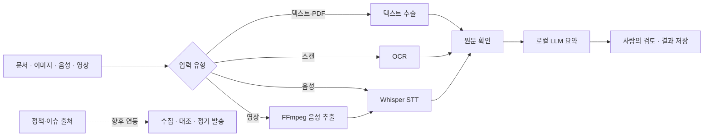
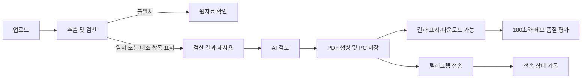

# 폴더·파일 구성과 운영 도구

```text
Quest_main_02/
├─ app/                 로컬 웹 서버와 입력 추출 파이프라인
├─ web/                 5개 업무 화면과 시연
├─ briefings/           정기 보고 메시지 생성 및 수동 Telegram 전송
├─ examples/            가상 입력 예시 (실제 기업 정보 금지)
├─ docs/                PRD, 참조 분석, 평가, 정기 브리핑, UI 감사
├─ tests/               출력·전송·오류 처리 테스트
├─ scripts/             브라우저 검증 스크립트
├─ output/playwright/   UI 검증 스크린샷
├─ data/runs/           로컬 실행 데이터 자리 (git 제외)
├─ models/              로컬 모델 다운로드 (git 제외)
├─ .venv/               독립 Python 환경 (git 제외)
├─ README.md, PRODUCT.md, DESIGN.md, AGENTS.md
└─ requirements.txt, .env.example, .gitignore
```

실제 첨부 자료는 원래 위치에 두고 저장소에 복사하지 않는다. 입력은 임시 폴더에서 처리 후 삭제한다. 실험 중 생성된 `output/demo/`, Telegram 발송 기록, 모델·비밀키는 git 제외다.



이 도식은 고정된 처리 흐름을 설명한다. 그래프 오케스트레이션 프레임워크가 설치되었다는 의미가 아니다. 영상의 화면과 자막은 현재 처리하지 않는다.

## 무엇이 필요한가
| 도구 | 지금 | 향후 |
|---|---|---|
| Skill | PDF·스프레드시트, 화면 design-taste-frontend·impeccable·Playwright: 자료 분석과 화면 검증에 사용 | PPTX/문서 제작 시 해당 스킬 적용 |
| Agent | 단일 작업자로 충분 | 독립 검토가 필요한 대규모 검증 때 재무 계산 검토·출처 검증 담당을 분리할 수 있음. 자동 에이전트 미설치 |
| Hook | 필수 아님 | 비밀키 감지·테스트·UI 검사 훅을 팀 합의 후 적용. 훅은 설치하지 않음 |
| MCP | 필수 아님 | 공식 정책 API나 승인된 사내 문서 연동이 필요할 때 해당 커넥터 검토. MCP 사용이 자동으로 출처 신뢰를 보장하지 않음 |
| 하네스 | 현재: CLI, 가상 예시, 제한 오류, unittest/Playwright, README | 실제 자료의 정답 세트·재현 실행·모델별 기록, 비용·시간 상한 추가 |
| 루프 | 현재: 사용자의 수동 확인과 테스트 | 수집→검증→발송의 명시적 목표, 중단 조건·재시도 상한을 먼저 정한 뒤 스케줄 연동 |
| 그래프 | 현재 파이프라인은 고정 순서이므로 필수 아님 | 분기·상태 저장·사람 승인·재시도가 복잡해질 때 LangGraph 등 검토. 설치하지 않음 |

## 단계별 우선순위
1. 회의록·문서요약의 실제 업무 샘플과 정답을 확보하고 STT/OCR→LLM→검토 시간을 평가한다.
2. 재무 간략·심층 원본 엑셀과 수식 및 PPT 구성 기준을 확정한다.
3. 정책·이슈의 출처·수신 채팅·부분 실패 및 휴일 정책을 정하고 실제 수집/발송/스케줄러를 통합한다.
4. 결과에 따라 승인 단계, 자동화 테스트, 루프나 그래프 도입 여부를 판단한다.


## 과제 제출용 실행 구조와 최적화

| 구성 | 실제 적용 |
|---|---|
| 폴더와 파일 | `app/finance_input.py`는 추출과 검산, `app/finance_review.py`는 정규화 결과 재사용, `app/finance_reports.py`는 PDF, `app/output_delivery.py`는 저장과 발송, `app/evaluation.py`는 효과 판정, `web/`은 입력과 결과 표시를 담당한다. |
| Skill | 종합보고서 스킬에서 데모 페이지를 PDF 쪽·엑셀 시트·셀과 대조한다. Playwright와 impeccable은 브라우저 동작·화면 검증에 사용한다. |
| Agent | 서비스 실행은 단일 업무 처리 흐름이다. 검산·판정은 결정적 코드가 담당하고 모델은 검토 문안을 작성한다. 사용자 확정과 데모 비교는 사람이 담당한다. |
| Hook | PDF와 발송 기록을 로컬에 저장한 직후 `on_saved` 콜백이 실행된다. 브라우저는 이 이벤트로 PDF를 먼저 표시하고, 이후 받은 이벤트로 발송 상태를 갱신한다. |
| MCP | 업로드·검산·PDF·발송의 필수 실행 경로에는 MCP가 없다. 자료 접근과 배포를 추가하는 경우에만 해당 연결을 검토한다. |
| 하네스 | `tests/`에서 토큰 검증·기한 경계·PDF·저장 순서를 점검한다. Playwright로 선택한 업무, 진행 상태와 다운로드를 확인한다. 측정·결과 기준은 [문제 정의 및 평가](문제정의_및_평가.md)에 기록한다. |
| 루프 | 재무 검산 결과를 서버 메모리에서 최대 8건, 발급 후 10분 이내에 재사용한다. 원자료는 재전송하지 않고 무작위 토큰과 검산 식별자를 사용한다. 입력 변경이나 만료 시 자료를 다시 확인한다. 전송 결과가 불명확하면 자동 중복 발송하지 않는다. |
| 그래프 | 아래는 실제 실행의 의존 순서다. PDF 준비를 텔레그램의 응답과 분리해 외부 네트워크 대기가 결과 열기를 막지 않도록 했다. |


