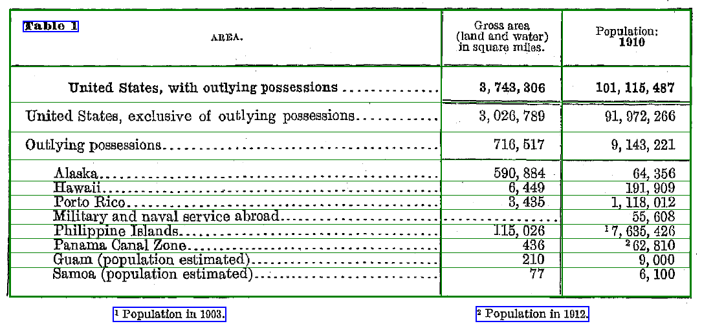

# 선택과제 B · OCR 텍스트와 표 구조 추출

## 바로가기

[프로젝트 소개](#프로젝트-소개) · [실행 파일](#실행-파일) · [실행 방법](#실행-방법) · [결과 보기](#결과-바로-보기) · [과제 제출](#과제-제출) · [로컬·GitHub 구조](#로컬과-github-폴더-매칭) · [검증](#검증)

## 프로젝트 소개

미국 인구조사국 1910 Census의 표 이미지에서 글자와 좌표를 인식하고, **일반 텍스트와 표를 분리**한 뒤 행·열 구조를 복원합니다. 자동 추출 결과와 원본 대조 후 교정 결과를 각각 보존합니다.

[과제 제출 안내·붙여 넣을 설명](SUBMISSION.md) · [최종 제출 ZIP](OCR_Assignment_Final.zip) · [PDF 보고서](OCR_Assignment_Report.pdf) · [GitHub 과제 폴더](https://github.com/sorek-charlie/AIFFEL-Quest/tree/main/과제_261110_OCR다시쓰기)

## 결과 바로 보기

| 결과 | 바로 열기 | 내용 |
|---|---|---|
| 수행 보고서 | [PDF 보고서](OCR_Assignment_Report.pdf) · [보고서 원문](REPORT.md) | OCR·텍스트/표 분리·자동 추출·교정 과정 |
| 입력 이미지 | [원본 표 이미지](프로그램%20파일/input/census-table.png) | 표·제목·각주를 포함한 1085 × 505 이미지 |
| 텍스트와 표 구분 | [구분 결과 이미지](참고자료/outputs/layout/layout_regions.png) | 초록색: 표·행·열 / 파란색: 제목·각주 |
| 표 외 텍스트 | [텍스트 파일](참고자료/outputs/layout/text.txt) | 제목 1개와 각주 2개, OCR 원문 유지 |
| 자동 추출 표 | [GitHub에서 표 보기](참고자료/outputs/layout/table_001.md) · [CSV](참고자료/outputs/layout/table_001.csv) · [HTML 파일](참고자료/outputs/layout/table_001.html) | 11행 × 3열, OCR 오독을 교정하지 않은 결과 |
| 구분된 문서 | [제목·표·각주 문서](참고자료/outputs/layout/document.md) | 텍스트와 표를 구분해 기록 |
| 구조 및 좌표 | [레이아웃 JSON](참고자료/outputs/layout/layout.json) | 표 경계·열 경계·행 중심·셀별 OCR id |
| 교정한 최종 표 | [교정 표와 해설](참고자료/outputs/ocr/document.md) · [교정 CSV](참고자료/outputs/ocr/table.csv) | 각주 연도·추정치·빈 값을 보존한 11행 × 5열 |
| 원시 OCR | [텍스트](참고자료/outputs/ocr/raw_text.txt) · [JSON](참고자료/outputs/ocr/raw_ocr.json) · [좌표](참고자료/outputs/ocr/text_coordinates.json) | 기존 모델 실행 결과 42개 영역 |
| OCR 시각화 | [OCR 영역과 id](참고자료/outputs/ocr/ocr_regions.png) | 각 영역을 원본과 대조 |
| 교정 근거 | [33개 셀 검토 기록](참고자료/outputs/ocr/review_log.csv) · [대표 오류](참고자료/outputs/ocr/corrections.csv) | 원시 인식값과 교정값의 대응 |
| 실행 기록 | [manifest](참고자료/outputs/ocr/manifest.json) · [기존 OCR 로그](참고자료/outputs/ocr/execution.log) · [점검 결과](참고자료/VALIDATION.txt) | 환경·출처·입력 해시·검증 범위 |

HTML 링크는 GitHub에서 소스 파일로 열립니다. 바로 읽는 표는 Markdown 링크를 사용하세요.

### 텍스트·표 구분 결과 미리보기



## 실행 파일

| 순서 | 실행 코드 | 역할 |
|---|---|---|
| 선택 | [prepare_input.py](프로그램%20파일/prepare_input.py) | 원문 PDF 2쪽을 200 dpi로 렌더링하고 표를 자름 |
| 1 | [run_ocr.py](프로그램%20파일/run_ocr.py) | PaddleOCR로 글자·점수·좌표·시각화를 저장 |
| 2 | [extract_layout.py](프로그램%20파일/extract_layout.py) | 이미지 구분선과 OCR 좌표로 텍스트·표 및 행·열 구조를 추출 |
| 3 | [reconstruct_table.py](프로그램%20파일/reconstruct_table.py) | [수동 검토값](프로그램%20파일/reviewed_cells.json)으로 교정된 CSV·문서·검토 기록을 생성 |
| 보고서 | [build_report.py](프로그램%20파일/build_report.py) | 최종 PDF와 Markdown 보고서 생성 |

[실행 패키지](프로그램%20파일/requirements.txt) · [직접 의존성 버전](프로그램%20파일/requirements-lock.txt) · [보고서 생성 패키지](프로그램%20파일/requirements-report.txt)

GitHub 링크는 코드를 엽니다. 실제 실행은 저장소를 내려받은 후 아래 명령을 사용합니다.

## 실행 방법

Python 3.12와 CPU를 기준으로 합니다. README가 있는 폴더에서 다음과 같이 프로그램 폴더로 이동한 후 실행하세요.

```powershell
cd "프로그램 파일"
python -m venv .venv
# Windows PowerShell
.\.venv\Scripts\Activate.ps1
# macOS/Linux: source .venv/bin/activate
python -m pip install -r requirements.txt
python run_ocr.py
python extract_layout.py
python reconstruct_table.py
```

기존 OCR 결과가 포함되어 있으므로 **구조 분리만 확인하려면** 다음 명령으로 실행할 수 있습니다.

```powershell
cd "프로그램 파일"
python -m pip install numpy opencv-python Pillow
python extract_layout.py
```

[설치 패키지](프로그램%20파일/requirements.txt)를 사용하세요. [직접 의존성 버전 목록](프로그램%20파일/requirements-lock.txt)은 전체 전이 의존성을 고정한 lock이 아닙니다. [이전 작업 환경 전체 목록](참고자료/environment-original.txt)은 참고용이며 설치 파일이 아닙니다. OpenCV와 NumPy는 구조 분리 단계에 사용합니다. 최초 OCR 실행에는 모델 다운로드를 위한 인터넷이 필요합니다.

입력 이미지는 포함되어 있습니다. 원문에서 다시 추출할 때만 Poppler의 `pdftoppm`을 설치하고 `python prepare_input.py`를 실행합니다. [공식 원문 PDF](참고자료/census_source.pdf)도 포함합니다.

## 처리 방식과 실제 결과

1. PaddleOCR 영어 모델이 42개 영역의 글자·좌표를 인식했습니다. 기존 실행 환경은 Linux, Python 3.12.14, CPU이며 세부 사항은 manifest에 보존되어 있습니다.
2. 추가한 구조 추출기는 이미지의 긴 수직·수평선을 검출해 표 외곽, 열 3개와 머리글 경계를 찾습니다. 첫 열의 OCR 행 위치를 기준으로 나머지 셀을 배치합니다. 수동 검토 JSON을 사용하지 않습니다.
3. 제목과 각주 2개를 텍스트로 분리하고, 표 본문 OCR 영역 33개(잡음 1개 포함)를 11행 × 3열에 중복 없이 배치했습니다. 원문에 면적이 없는 셀은 비어 있습니다.
4. 자동 표의 `1010`, `17,635,426`, `262,810` 등은 OCR 원문 그대로 남깁니다. 원본 대조 후 교정된 값은 별도 교정 표에 저장합니다. 필리핀 인구는 1903년, 파나마는 1912년이며 Guam·Samoa는 추정치입니다.

## 범위와 한계

- 구조 추출은 **포함된 단일 유선 표에 맞춘 휴리스틱**입니다. 무선 표, 병합 셀, 여러 표, 여러 줄 행 제목을 일반적으로 처리하지 않습니다. 표 제목은 첫 열 상단 모서리 위치로 구분합니다.
- 입력이 표 주변으로 잘린 이미지이므로 전체 페이지 본문을 인식·분류한 결과가 아닙니다. 전체 페이지 처리는 페이지 전체 OCR 및 레이아웃 검출이 추가로 필요합니다.
- 구조 추출과 문자 교정은 별도입니다. 교정값은 사람이 원본과 대조한 입력을 사용하며, 자동 범용 교정이나 정확도 벤치마크를 수행했다고 주장하지 않습니다.
- 전체·소계·구성 행이 함께 있으므로 11행을 단순 합산하면 중복 집계됩니다.
- PDF 보고서에도 텍스트·표 분리 과정, 자동 추출 표, 교정 결과와 검증 내용을 반영했습니다.

## 검증

현재 Windows PC에서 구조 추출과 교정 표 재생성을 실행했습니다. 11행 × 3열, 텍스트 블록 3개, 본문 OCR id 중복 배치 없음, 원문 미기재 면적의 빈 값, 자동 추출값의 오독 보존을 확인했습니다. 입력 SHA256, 최종 PDF 7쪽 및 최종 ZIP 무결성도 확인했습니다. 이번 점검에서는 전체 OCR 추론 및 새 가상환경 설치는 재실행하지 않았습니다.

## 출처 및 제출

- 자료: [U.S. Census Bureau 공식 원문](https://www2.census.gov/library/publications/decennial/1910/volume-1/volume-1-p3.pdf), PDF 2쪽 / 인쇄 22쪽 Table 1.
- 과제 기록: 강의자료 「노드04_AI가 문서와 사진에서」 8~10쪽 선택과제 B. 원본 강의자료는 현재 폴더에 없어 세부 지시사항을 독립적으로 재확인하지 못했습니다.

## PDF 보고서 다시 만들기

[보고서 생성 코드](프로그램%20파일/build_report.py)를 제공합니다. `프로그램 파일`에서 `python -m pip install -r requirements-report.txt` 후 `python build_report.py`를 실행하세요. Windows 맑은 고딕을 사용하며 다른 OS에서는 코드의 한국어 TTF 경로를 지정해야 합니다.

## 과제 제출

| 제출 항목 | 바로 열기 | 용도 |
|---|---|---|
| 제출 안내와 설명문 | [SUBMISSION.md](SUBMISSION.md) | 제출 순서와 제출란에 붙여 넣을 내용 |
| 제출 링크 | [GitHub 과제 폴더](https://github.com/sorek-charlie/AIFFEL-Quest/tree/main/과제_261110_OCR다시쓰기) | 링크 제출 시 사용 |
| 전체 제출 파일 | [최종 ZIP](OCR_Assignment_Final.zip) | 코드·입력·결과·문서 전체 |
| 최종 보고서 | [PDF](OCR_Assignment_Report.pdf) · [Markdown](REPORT.md) | 7쪽 수행 보고서 |
| 자동 표 | [표 보기](참고자료/outputs/layout/table_001.md) · [CSV](참고자료/outputs/layout/table_001.csv) | 11행 × 3열 자동 구조 추출 결과 |
| 교정 표 | [표와 해설](참고자료/outputs/ocr/document.md) · [CSV](참고자료/outputs/ocr/table.csv) | 원본 대조 후 교정 결과 |
| 분리된 텍스트 | [text.txt](참고자료/outputs/layout/text.txt) | 표 제목과 각주 |
| 검증 근거 | [검증 기록](참고자료/VALIDATION.txt) · [셀 검토 로그](참고자료/outputs/ocr/review_log.csv) | 실행·원본 대조 확인 |

강의 제출란에 GitHub 과제 폴더 주소를 입력하세요. 파일 첨부 방식이면 ZIP과 PDF를 사용하세요. 채점자가 저장소를 열 수 있는지 확인한 뒤 제출 완료 상태를 확인합니다.

## 로컬과 GitHub 폴더 매칭

로컬 `OCR다시쓰기`는 `AIFFEL-Quest` 저장소와 연결되어 있습니다. 다른 과제는 sparse checkout으로 숨겨져 있으며, 아래 과제 하위 경로는 로컬과 GitHub에서 동일합니다.

| 로컬 위치 (현재 작업 폴더 기준) | GitHub 위치 |
|---|---|
| `과제_261110_OCR다시쓰기/` | [과제 루트](https://github.com/sorek-charlie/AIFFEL-Quest/tree/main/과제_261110_OCR다시쓰기) |
| `과제_261110_OCR다시쓰기/프로그램 파일/` | [프로그램 파일](프로그램%20파일/) |
| `과제_261110_OCR다시쓰기/프로그램 파일/input/` | [입력 이미지 폴더](프로그램%20파일/input/) |
| `과제_261110_OCR다시쓰기/참고자료/` | [참고자료](참고자료/) |
| `과제_261110_OCR다시쓰기/참고자료/outputs/layout/` | [텍스트·표 분리 결과](참고자료/outputs/layout/) |
| `과제_261110_OCR다시쓰기/참고자료/outputs/ocr/` | [OCR·교정 결과](참고자료/outputs/ocr/) |
| `과제_261110_OCR다시쓰기/README.md` | [현재 README](README.md) |
| `과제_261110_OCR다시쓰기/SUBMISSION.md` | [과제 제출 안내](SUBMISSION.md) |

로컬 최상위의 `제출파일/`은 이 과제 폴더에 있는 최종 ZIP·PDF의 편의용 복사본입니다. 최상위 `제출안내.txt`와 `.git/`은 로컬 안내·연결 정보이며 과제 제출 경로는 위 표를 따릅니다.

```text
과제_261110_OCR다시쓰기/           # 로컬·GitHub 공통 경로
├─ README.md                    # 소개·실행·결과·제출 링크
├─ SUBMISSION.md                # 제출 순서·제출 설명문
├─ REPORT.md                    # 보고서 원문
├─ OCR_Assignment_Report.pdf    # 최종 보고서
├─ OCR_Assignment_Final.zip     # 전체 제출 묶음
├─ .gitattributes               # 파일 바이트 보존 설정
├─ 프로그램 파일/
│  ├─ input/census-table.png    # OCR 입력
│  ├─ prepare_input.py          # 원문 이미지 준비
│  ├─ run_ocr.py                # 글자·좌표 인식
│  ├─ extract_layout.py         # 텍스트·표 구조 분리
│  ├─ reconstruct_table.py      # 검토 후 교정 표 생성
│  ├─ build_report.py           # 보고서 생성
│  ├─ reviewed_cells.json       # 수동 검토값
│  ├─ requirements.txt          # 실행 의존성
│  ├─ requirements-lock.txt     # 직접 의존성 버전 목록
│  ├─ requirements-report.txt   # 보고서 의존성
│  └─ .gitignore                # 가상환경·캐시 제외
└─ 참고자료/
   ├─ census_source.pdf         # 공식 원문
   ├─ environment-original.txt  # 최초 실행 환경
   ├─ VALIDATION.txt            # 검증 기록
   └─ outputs/
      ├─ layout/                # 자동 구조 추출 결과
      │  ├─ text.txt
      │  ├─ table_001.csv / .md / .html
      │  ├─ document.md
      │  ├─ layout.json
      │  └─ layout_regions.png
      └─ ocr/                   # 원시 OCR·교정 표·근거
         ├─ raw_ocr.json / raw_text.txt
         ├─ text_coordinates.json
         ├─ table.csv / document.md
         ├─ corrections.csv / review_log.csv
         ├─ manifest.json / execution.log
         └─ input_copy.png / ocr_regions.png / census-table_ocr_res_img.png
```

경로에 공백이 있는 `프로그램 파일` 링크는 `%20`으로 표기해 GitHub와 로컬 Markdown에서 열리도록 했습니다. `.py` 링크는 코드 열기 기능이며 실행은 터미널에서 안내된 명령을 사용합니다.
