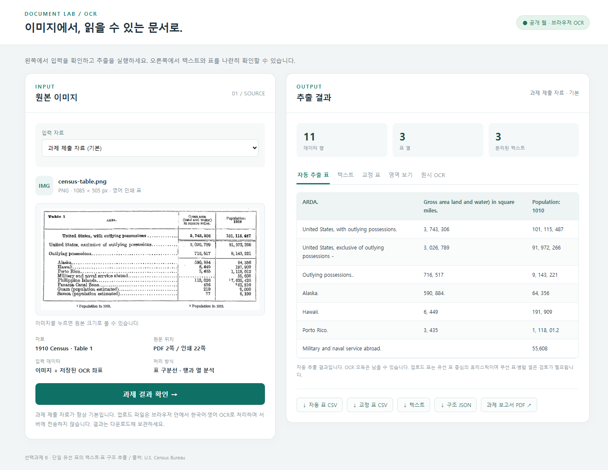

# 선택과제 B · OCR 문서화

**[▶ 실행 웹 열기](https://sorek-ocr-document-lab-261110.cherrysocute9.chatgpt.site)**

과제 제출 자료를 기본으로 확인하고, 다른 PDF·이미지를 선택해 한국어·영어 OCR을 실행할 수 있습니다. 설치나 로그인 없이 브라우저에서 사용합니다.

## 과제결과

| 제출 내용 | 바로 열기 |
|---|---|
| 최종 보고서 | [PDF 보고서 · 10쪽](OCR_Assignment_Report.pdf) · [보고서 원문](REPORT.md) |
| 텍스트와 표 분리 결과 | [분리된 텍스트](참고자료/outputs/layout/text.txt) · [자동 추출 표](참고자료/outputs/layout/table_001.md) · [CSV](참고자료/outputs/layout/table_001.csv) |
| 교정한 최종 문서 | [표와 해설](참고자료/outputs/ocr/document.md) · [최종 CSV](참고자료/outputs/ocr/table.csv) |
| 입력과 출처 | [입력 이미지](프로그램%20파일/input/census-table.png) · [공식 원문 PDF](참고자료/census_source.pdf) |
| 원본 대조와 오류 수정 | [OCR 영역·번호](참고자료/outputs/ocr/ocr_regions.png) · [33개 셀 검토 기록](참고자료/outputs/ocr/review_log.csv) · [대표 오류와 수정값](참고자료/outputs/ocr/corrections.csv) |
| 실제 실행 근거 | [원시 OCR](참고자료/outputs/ocr/raw_text.txt) · [환경·입력 해시](참고자료/outputs/ocr/manifest.json) · [기존 실행 로그](참고자료/outputs/ocr/execution.log) |
| 웹·업로드 검증 | [공개 웹 검증](참고자료/PUBLIC_DEPLOYMENT.json) · [로컬 업로드 검증](참고자료/UPLOAD_VALIDATION.json) · [전체 점검 기록](참고자료/VALIDATION.txt) |
| 전체 제출물 | [최종 제출 ZIP](OCR_Assignment_Final.zip) |

## 기능과 사용 방법

1. 위 **실행 웹 열기**를 누릅니다. 기본 화면은 과제 제출 자료입니다.
2. 왼쪽 **INPUT**에서 원본을 확인하고 오른쪽 **OUTPUT**에서 텍스트·표·교정 표·영역을 확인합니다.
3. 다른 문서는 입력 자료를 **다른 PDF·이미지 업로드**로 바꾸고 파일과 언어를 선택합니다.
4. OCR을 실행한 뒤 PDF 페이지를 선택하고 표 CSV·텍스트·좌표 JSON을 다운로드합니다.
5. 과제 제출 자료로 전환하거나 새로고침하면 기본 화면으로 돌아옵니다.

공개 웹은 PDF·PNG·JPG·WEBP·BMP, 한국어·영어를 지원합니다. 파일은 최대 30MB, PDF는 최대 50쪽입니다. 파일과 OCR 결과는 방문자 브라우저에서 처리하며 앱 서버로 전송·저장하지 않습니다. 보관할 결과는 직접 다운로드하세요. 처음 실행할 때 OCR 엔진과 언어 데이터를 불러오므로 시간이 걸릴 수 있습니다.



## 처리 방식과 결과 해석

**기본 과제**는 미국 인구조사국 1910 Census 표입니다. PaddleOCR의 기존 42개 인식 영역에서 구조를 복원한 11행 × 3열 표와 제목·각주 3개를 제공합니다. 교정 결과는 원본을 대조한 수동 검토값을 사용합니다. 공개 웹의 기본 과제는 이 저장된 결과를 표시합니다.

**외부 PDF·이미지**는 Tesseract.js와 PDF.js로 브라우저에서 실제 OCR을 실행합니다. PDF를 페이지별 이미지로 렌더링하고, 글자 인식용 이미지의 긴 표 선을 제거한 뒤 원본 선 구조와 단어 좌표로 표·텍스트를 구분합니다. 외부 문서에는 과제의 수동 교정값을 적용하지 않습니다.

유선 표 중심의 휴리스틱이며 무선 표·병합 셀·복잡한 다단 문서는 원본 검토가 필요합니다. OCR 오독은 남을 수 있습니다. 공개 PDF 테스트에서도 숫자 67890이 6/890으로 인식된 사례를 검증 기록에 남겼습니다. 기본 과제의 각주 연도·추정치·원문 미기재 값은 교정 표에 별도로 보존했습니다.

이미지와 2쪽 스캔 PDF를 로그인하지 않은 새 브라우저에서 실제 처리해 한국어·영어 OCR, 표 분리, 페이지 전환, 다운로드와 기본 과제 복귀를 확인했습니다. 공개 웹의 라이브러리 버전과 전처리는 로컬 Python 버전과 달라 인식 결과에 차이가 있을 수 있습니다.

## 파일 구성과 GitHub 대응

```text
과제_261110_OCR다시쓰기/            # 로컬과 GitHub의 동일 경로
├─ README.md                      # 실행 웹·과제결과 링크와 설명
├─ OCR_Assignment_Report.pdf       # 10쪽 보고서: 과제·로컬 웹·업로드 OCR
├─ REPORT.md                       # 같은 보고서의 원문
├─ OCR_Assignment_Final.zip        # 전체 제출 묶음
├─ SUBMISSION.md / WEB_USAGE.md    # 제출 설명·상세 사용법
├─ 프로그램 파일/
│  ├─ public-web/                  # 공개 웹 소스·빌드 설정
│  ├─ web_app.py / web/index.html  # 선택 사항: 로컬 Python 웹
│  ├─ upload_ocr.py                 # 로컬 PDF·이미지 OCR
│  ├─ run_ocr.py                    # 기본 과제 PaddleOCR 실행
│  ├─ extract_layout.py             # 기본 과제 텍스트·표 분리
│  ├─ reconstruct_table.py          # 수동 검토값으로 교정 표 생성
│  ├─ build_report.py               # 보고서 재생성
│  ├─ reviewed_cells.json           # 수동 검토값
│  ├─ input/census-table.png        # 기본 과제 입력
│  └─ requirements*.txt             # 기능별 Python 패키지 목록
└─ 참고자료/
   ├─ census_source.pdf             # 공식 원문
   ├─ outputs/layout/               # 자동 텍스트·표 분리 결과
   ├─ outputs/ocr/                  # 원시 OCR·교정 표·대조 기록
   ├─ PUBLIC_DEPLOYMENT.json        # 공개 배포·익명 방문자 검증
   └─ *VALIDATION*.json / .txt       # 실행·보고서 검증 기록
```

현재 작업 폴더의 `과제_261110_OCR다시쓰기/`가 GitHub의 같은 이름 폴더와 대응합니다. 최상위 `제출파일/`은 최종 ZIP·PDF의 로컬 편의용 복사본입니다. 사용자 업로드, .git, node_modules, 가상환경·캐시는 제출 ZIP에 포함하지 않습니다.

## 개발·로컬 실행 설명

일반 사용자는 위 공개 웹 링크만 누르면 됩니다. 다음은 코드를 확인하거나 직접 실행할 때 사용하는 설명입니다.

- 공개 웹 소스: [public-web](프로그램%20파일/public-web/), [브라우저 OCR 코드](프로그램%20파일/public-web/src/app.js), [화면 HTML](프로그램%20파일/public-web/src/index.html). 해당 폴더에서 `npm ci` 후 `npm run build`를 실행하면 `dist/`가 생성됩니다.
- 로컬 Python 웹: [web_app.py](프로그램%20파일/web_app.py), [upload_ocr.py](프로그램%20파일/upload_ocr.py). `프로그램 파일`에서 `python -m pip install -r requirements-web.txt` 후 `python web_app.py`를 실행합니다. 로컬 업로드 OCR은 별도 Tesseract와 kor/eng 언어 데이터가 필요하며 [상세 사용법](WEB_USAGE.md)에 설명했습니다.
- 기본 과제 코드: [run_ocr.py](프로그램%20파일/run_ocr.py) → [extract_layout.py](프로그램%20파일/extract_layout.py) → [reconstruct_table.py](프로그램%20파일/reconstruct_table.py). 전체 OCR 재실행에는 requirements.txt와 최초 모델 다운로드가 필요합니다.
- 보고서 재생성: [build_report.py](프로그램%20파일/build_report.py). requirements-report.txt와 Windows 맑은 고딕을 사용합니다. 다른 OS에서는 한국어 TTF 경로를 지정하세요.

10쪽 PDF 보고서는 과제 처리와 로컬 Python 웹·업로드 OCR을 설명합니다. 이후 추가한 공개 브라우저 버전의 배포 주소·구현·검증 내용은 이 README와 PUBLIC_DEPLOYMENT.json을 함께 확인하세요.

## 제출 설명

강의 제출란에는 이 GitHub 과제 폴더 주소를 입력하고, 웹 실행 확인용으로 공개 웹 주소도 함께 적으면 됩니다. 파일 제출 방식이면 최종 ZIP과 PDF를 첨부합니다. [제출란에 사용할 설명문](SUBMISSION.md)에 정리했습니다. 강의 사이트 제출 버튼은 자동으로 누르지 않았습니다.

자료 출처는 미국 인구조사국의 1910 Census Volume I, PDF 2쪽 / 인쇄 22쪽 Table 1입니다. 기존 과제 요구사항 출처는 강의자료 「노드04_AI가 문서와 사진에서」 8~10쪽이며 강의 원본 파일은 현재 작업 폴더에 없습니다.
