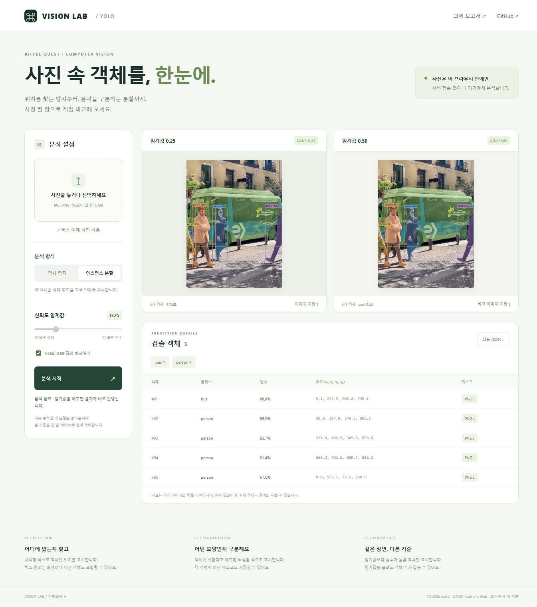

# YOLO Vision Lab · 객체 탐지와 인스턴스 분할

사진에서 객체의 위치와 모양을 찾고 신뢰도 임계값에 따른 결과를 비교하는 AIFFEL 선택과제 A입니다.

## 웹으로 실행

### [공개 웹앱 열기 ↗](https://yolo-vision-lab-261110.cherrysocute9.chatgpt.site)

설치 없이 브라우저에서 사용합니다. 예제 버스 사진을 그대로 분석하거나 JPG·PNG·WEBP 사진을 선택하세요. 사진은 서버에 업로드하지 않고 사용자의 브라우저 안에서 처리합니다. 첫 분석 때 모델과 브라우저 추론 런타임을 내려받습니다.

1. 사진을 선택하거나 버스 예제를 사용합니다.
2. 객체 탐지 또는 인스턴스 분할을 선택하고 **분석 시작**을 누릅니다.
3. 임계값을 조절하거나 **0.25와 0.50 비교**를 선택합니다.
4. 결과 이미지, 좌표 JSON, 객체별 이진 마스크 PNG를 저장합니다.

큰 사진은 긴 변 1600px로 줄여 처리합니다. 점수는 정확도를 보장하는 확률이 아니며, 예측 결과는 실제 객체·경계와 다를 수 있습니다.

## 폴더 구성

- [실행프로그램](실행프로그램/): 웹앱, 브라우저용 모델, Python 원본 코드·모델·입력 사진
- [과제제출내용](과제제출내용/): 보고서, 기존 실행 결과, 웹 검증 기록

로컬과 GitHub 과제 폴더의 구조를 동일하게 유지합니다. 가상환경, node_modules, 로컬 재실행 결과와 Sites 저장소 메타데이터는 GitHub 업로드에서 제외합니다. EXE 실행파일 및 EXE Releases 배포는 삭제하고 웹으로 전환했습니다.

## 프로그램·실행 링크

| 항목 | 바로 열기 |
|---|---|
| 공개 웹앱 | [Vision Lab](https://yolo-vision-lab-261110.cherrysocute9.chatgpt.site) |
| 웹 개발·로컬 실행 안내 | [web/README.md](실행프로그램/web/README.md) |
| 웹 화면 | [index.html](실행프로그램/web/dist/index.html) · [CSS](실행프로그램/web/dist/style.css) |
| 웹 기능 | [app.js](실행프로그램/web/dist/app.js) |
| 추론·NMS·마스크 계산 | [inference.js](실행프로그램/web/dist/inference.js) |
| 웹용 모델 | [탐지 ONNX](실행프로그램/web/dist/models/detect.onnx) · [분할 ONNX](실행프로그램/web/dist/models/segment.onnx) · [모델 정보](실행프로그램/web/dist/models/metadata.json) |
| 모델 변환 | [export_web.py](실행프로그램/export_web.py) · [변환 패키지](실행프로그램/requirements-web-export.txt) |
| 원본 Python 실행 | [run.py](실행프로그램/run.py) · [설치 목록](실행프로그램/requirements.txt) · [Windows 패키지](실행프로그램/requirements-windows-verified.txt) |
| 입력 사진 | [bus.jpg](실행프로그램/input/bus.jpg) |

## 과제 제출 자료

| 항목 | 바로 열기 |
|---|---|
| 제출 보고서 | [PDF](과제제출내용/Bus_Assignment_Report.pdf) · [텍스트](과제제출내용/REPORT.md) |
| 웹 실행 검증 | [WEB_CHECK.md](과제제출내용/WEB_CHECK.md) · [실행 화면](과제제출내용/web-preview.png) |
| Python 실행 검증 | [Windows 기록](과제제출내용/WINDOWS_RUN_CHECK.txt) · [파일 점검](과제제출내용/SUBMISSION_CHECK.txt) |
| 기존 결과 요약 | [summary.json](과제제출내용/outputs/windows_verified/summary.json) · [manifest.json](과제제출내용/outputs/windows_verified/manifest.json) |
| 탐지 비교 | [비교 이미지](과제제출내용/outputs/windows_verified/detect_comparison.jpg) |
| 분할 비교 | [비교 이미지](과제제출내용/outputs/windows_verified/segment_comparison.jpg) |
| 최초 Linux 결과 | [실행 폴더](과제제출내용/outputs/yolo/) · [manifest](과제제출내용/outputs/yolo/manifest.json) |

| 작업 / 임계값 | 기존 결과 이미지 | 좌표·점수 | 마스크 |
|---|---|---|---|
| 탐지 / 0.25 | [PNG/JPG](과제제출내용/outputs/windows_verified/detect_0.25/result.jpg) | [JSON](과제제출내용/outputs/windows_verified/detect_0.25/boxes.json) | — |
| 탐지 / 0.50 | [PNG/JPG](과제제출내용/outputs/windows_verified/detect_0.50/result.jpg) | [JSON](과제제출내용/outputs/windows_verified/detect_0.50/boxes.json) | — |
| 분할 / 0.25 | [PNG/JPG](과제제출내용/outputs/windows_verified/segment_0.25/result.jpg) | [JSON](과제제출내용/outputs/windows_verified/segment_0.25/boxes.json) | [객체별 PNG](과제제출내용/outputs/windows_verified/segment_0.25/) |
| 분할 / 0.50 | [PNG/JPG](과제제출내용/outputs/windows_verified/segment_0.50/result.jpg) | [JSON](과제제출내용/outputs/windows_verified/segment_0.50/boxes.json) | [객체별 PNG](과제제출내용/outputs/windows_verified/segment_0.50/) |

버스 예제에서 웹 탐지·분할 모두 conf 0.25/0.50에 버스 1대·사람 4명이 나왔습니다. 웹은 고정 640×640 ONNX 입력을 사용하므로 전처리·후처리가 다른 최초 Python 실행과 점수·좌표·마스크는 일부 다를 수 있습니다. 기존 보고서는 최초 실행 기록으로 보존하고 웹 관찰값은 별도로 기록했습니다. 정답 데이터가 없어 precision·recall·IoU·mAP는 보고하지 않습니다.

## 과제 제출

[이 GitHub 과제 폴더](https://github.com/sorek-charlie/AIFFEL-Quest/tree/main/과제_261110_YOLO서비스)와 [공개 웹앱](https://yolo-vision-lab-261110.cherrysocute9.chatgpt.site) 주소를 제출하면 코드·보고서 검토와 실제 웹 실행이 가능합니다. 강의의 학번·이름·제출 형식 규칙은 별도로 적용하세요.

## 참고

[Ultralytics 추론](https://docs.ultralytics.com/modes/predict/) · [ONNX 내보내기](https://docs.ultralytics.com/modes/export/) · [ONNX Runtime Web](https://onnxruntime.ai/docs/get-started/with-javascript/web.html)

과제 지시 원문은 기존 보고서가 인용한 「노드04_AI가 문서와 사진에서」 7~10쪽입니다. 현재 폴더에 원문이 없어 요구 조건 자체를 재확인하지 못했습니다. 입력 사진의 원 촬영자·재배포 조건은 미확인입니다. Ultralytics 모델·도구의 AGPL-3.0 또는 Enterprise 조건을 확인하세요.
